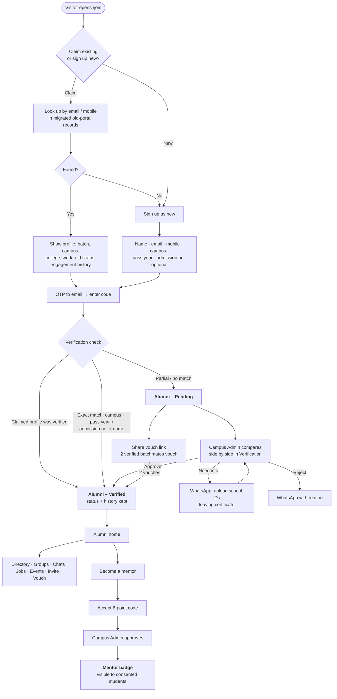
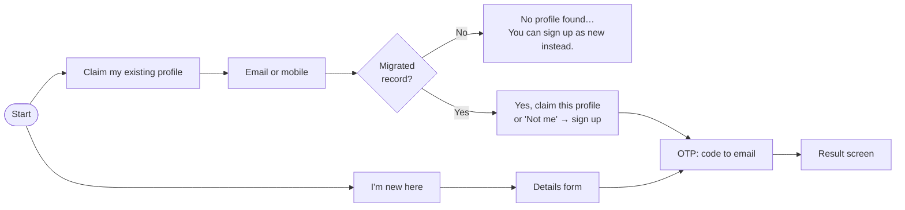
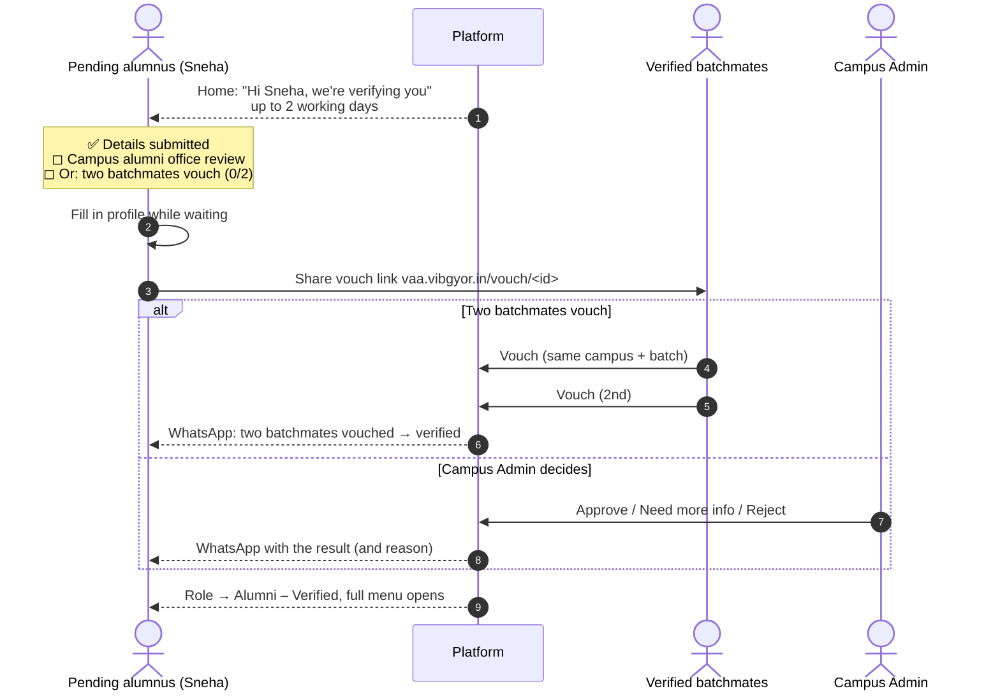
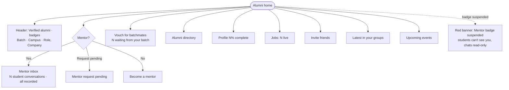
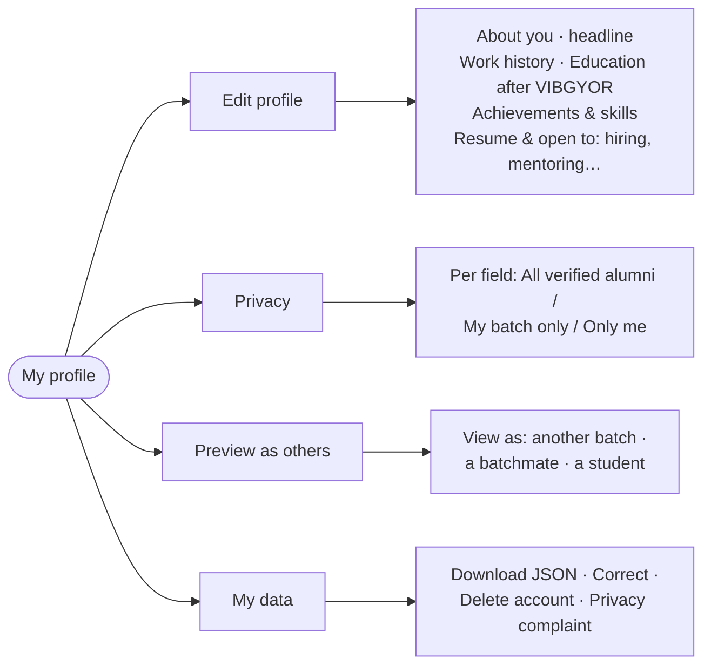
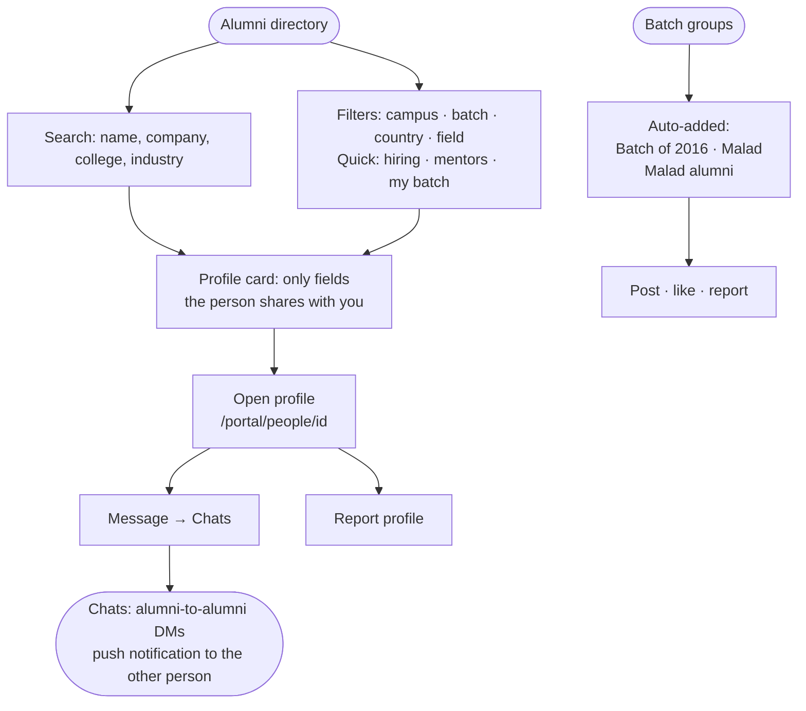
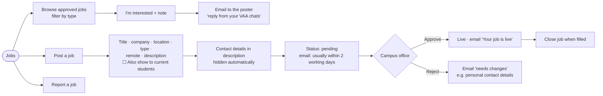
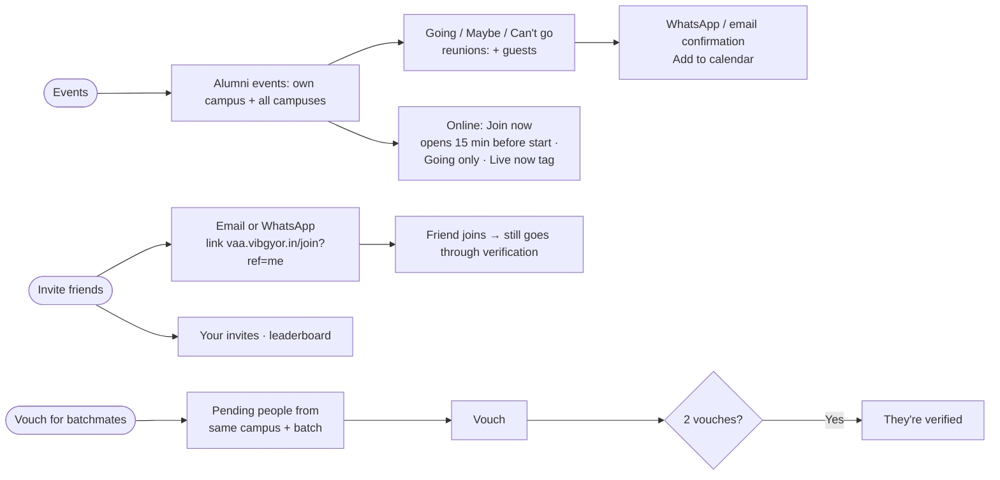
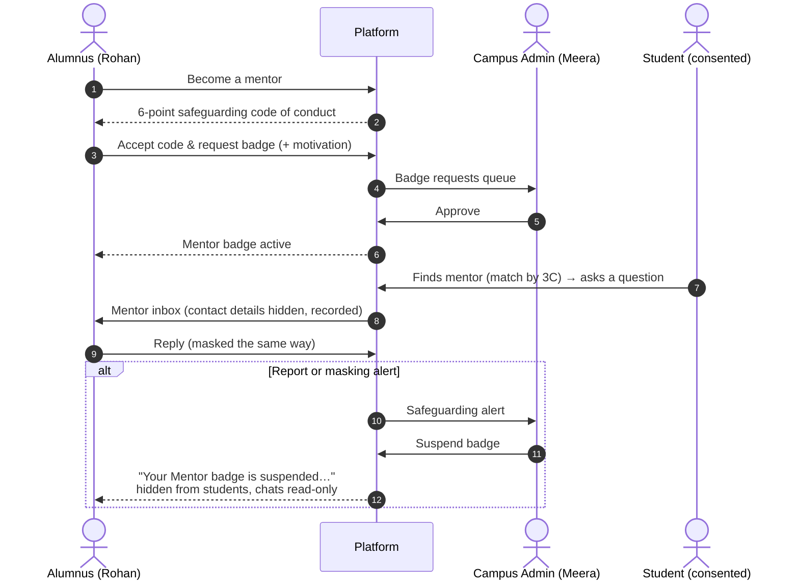
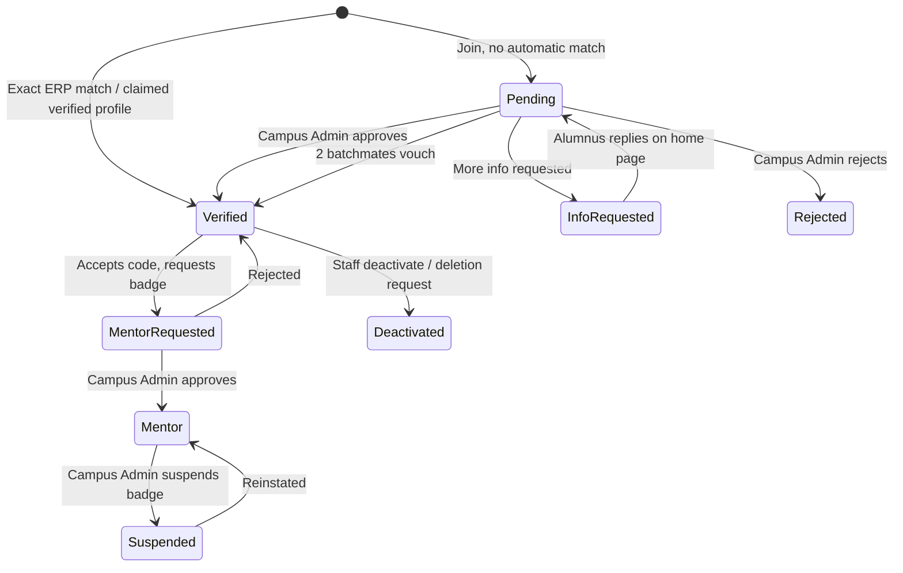

# VIBGYOR Alumni Platform: Alumni Flow

> Role codes **ALP** (Alumni – Pending) and **ALU** (Alumni – Verified), plus the **Mentor badge** an ALU can hold. Built from the prototype source (`src/app/join/page.tsx`, `lib/store.tsx` → `submitVerification` / `decideVerification` / `vouch` / `applyBadge` / `decideBadge` / `postJob` / `sendInvite`, `components/Homes.tsx` → `PendingAlumniHome` / `AlumniHome`, `app/portal/profile/page.tsx`, `lib/community.ts` → `canSee` / `groupsFor`, `app/portal/directory`, `groups`, `chats`, `jobs`, `events`, `invite`, `vouch`, `mentor`, `messages`). See also [STUDENT-FLOW.md](STUDENT-FLOW.md) and [PARENT-FLOW.md](PARENT-FLOW.md).

Demo personas: **Priya Sharma (`alu1`)**, verified mentor · **Rohan Gupta (`alu7`)**, verified, not a mentor · **Sneha Kulkarni (`alp1`)**, pending.

---

## 1. Who alumni are on the platform

| Item | ALP – Pending | ALU – Verified | ALU + Mentor badge |
|---|---|---|---|
| Who | Signed up or claimed a profile, not yet verified | Verified former VIBGYOR student | Verified alumnus approved to guide students |
| How you get here | Join / claim, no automatic match | Exact school-records match, claimed verified profile, Campus Admin approval, or 2 vouches | Accept code of conduct → Campus Admin approves |
| Login | OTP (email / mobile) | OTP (email / mobile) | OTP (email / mobile) |
| Scope | Own profile only | Community: all 39 campuses | Community + consented students |
| Menu | Home · My profile · Alumni directory 🔒 | Home · My profile · Alumni directory · Batch groups · Chats · Jobs · Events · Invite friends · Vouch for batchmates · Become a mentor | Same + **Mentor inbox** · *Mentor badge* |

### What alumni can do

| # | Action | ALP | ALU | Mentor |
|---|---|---|---|---|
| 1 | Join or claim an old-portal profile | ✅ | – | – |
| 2 | Fill in profile (about, work, education, skills, resume, open to) | ✅ | ✅ | ✅ |
| 3 | Set privacy per field, preview as others | ✅ | ✅ | ✅ |
| 4 | Download data / ask for correction / deletion / complaint (*My data*) | ✅ | ✅ | ✅ |
| 5 | Share a vouch link with batchmates | ✅ | – | – |
| 6 | Search the alumni directory, open profiles | 🔒 | ✅ | ✅ |
| 7 | Post and like in batch + campus groups | – | ✅ | ✅ |
| 8 | Direct-message other alumni (Chats) | – | ✅ | ✅ |
| 9 | Browse jobs, mark interest, post a job (campus approves) | – | ✅ | ✅ |
| 10 | RSVP to alumni events (+ guests for reunions), add to calendar | – | ✅ | ✅ |
| 11 | Invite friends by email / WhatsApp | – | ✅ | ✅ |
| 12 | Vouch for pending batchmates | – | ✅ | ✅ |
| 13 | Report a post, profile or job | – | ✅ | ✅ |
| 14 | Request the Mentor badge | – | ✅ | – |
| 15 | Answer students in the Mentor inbox | – | – | ✅ |

### What alumni cannot do

- ❌ See students or parents, or browse them (students only reach mentors, and only through the platform)
- ❌ Share phone, email, links or handles with students (hidden automatically)
- ❌ Meet a student in person or by video outside sessions booked on the platform
- ❌ Change batch or campus (from school records)
- ❌ Post a job that goes live without campus approval
- ❌ Pending alumni: directory, groups, chats, jobs, events (*"This opens as soon as your campus verifies you. You can complete your profile meanwhile."*)

---

## 2. Master flow (end to end)

---

## 3. Flow 1: Join or claim a profile

> **Or: invited by the alumni office.** Staff can send a login link from **Alumni records** (email / WhatsApp / SMS). The link opens `/login` with the alumnus's email already filled in; they tap *Send code*, enter the 6-digit code and they're in. No password is ever sent. See [CAD-FLOW.md](CAD-FLOW.md) → *Sending a login link*.

Steps on screen: **Start → Claim / Details → Found → Verify (OTP) → Result**.

### Verification outcomes

| Outcome | When | What happens |
|---|---|---|
| **Claimed, verified** | Claimed an old-portal profile that was already verified | Verified at once; batch, verified status and engagement history kept |
| **Verified (exact match)** | Campus + pass year + admission no. match a school ERP record, and the name matches | Verified at once: *"Your pass year, admission number and name match school records"* |
| **Pending** | Partial match (e.g. typo in admission no.) or no ERP record (old batches) | Goes to the Campus Admin's **Verification** queue with field-by-field checks; vouch link shown |

Demo fill buttons on the form: *exact match → auto-verified* (Karan Malhotra, 2014), *typo in admission no. → staff queue* (Pooja Reddy, 2019), *2007 batch, no ERP record → queue + peer vouch* (Rahul Desai).

---

## 4. Flow 2: While pending

The directory menu item shows a 🔒 until verified.

---

## 5. Flow 3: Alumni home (verified)

---

## 6. Flow 4: Profile, privacy and my data

### Default privacy

| Field | Default | Options |
|---|---|---|
| Email address | Only me | All verified alumni · My batch only · Only me |
| Mobile number | Only me | 〃 |
| Current company | All verified alumni | 〃 |
| City | All verified alumni | 〃 |
| Work history | All verified alumni | 〃 |
| Higher education | All verified alumni | 〃 |

- Batch and campus come from school records and can't be changed.
- **Students and parents never see the directory.** If you're a mentor, students see only name, batch, college, course, current role and short bio, never contact details.
- Campus office staff see the full record; every view is written to the audit log.

---

## 7. Flow 5: Community (directory, groups, chats)

Groups banner: *"You're added automatically to your batch and your campus. Only verified alumni can see these posts."*

---

## 8. Flow 6: Jobs

Jobs marked *Also show to current students* appear on the student **Internships** page; students apply through their career counsellor, never directly.

---

## 9. Flow 7: Events, invites, vouching

---

## 10. Flow 8: Becoming a mentor and the Mentor inbox

### Safeguarding code of conduct (draft wording)

1. Keep every conversation with students on the platform; never ask for or share phone numbers, emails or social media.
2. All messages with students are recorded and can be read by the campus alumni office and the student's parent, who may also join the conversation.
3. No meeting a student in person or by video outside sessions booked through the platform.
4. Honest guidance; never sell or promote paid services to students.
5. Report anything worrying about a student's safety to the campus alumni office straight away.
6. VIBGYOR can suspend the Mentor badge immediately if the code is broken.

### Mentor inbox rules

| Rule | Detail |
|---|---|
| Who messages first | Only the student starts a conversation |
| What's hidden | Phone, email, links, @handles → `[phone hidden]` etc.; campus notified |
| Read-only when | Student's parent switches off Mentor contact · student account paused · badge suspended |
| Video calls | Not in Release 1 |
| Deleting | Not possible; kept for safeguarding |
| Who else reads | Campus alumni office **and the student's parent**; banner in the inbox says so |
| Parent messages | A parent can **join** the child's conversation; their messages show as *<Name> · <Child>'s parent* and the mentor gets a push. Reply in the same thread |

---

## 11. Status lifecycle

---

## 12. Gaps and fixes

| # | Item | Status |
|---|---|---|
| 1 | Invites were never marked **Joined** | ✅ **Fixed.** The invite message links to `/join?ref=<inviter>`; on sign-up the matching invite (same email or mobile) is marked joined, or a joined record is added for the inviter. The leaderboard counts it |
| 2 | Pending home didn't change after *More info* or *Reject* | ✅ **Fixed.** *More info*: shows the office's question and a reply box; sending puts the request back in the Verification queue (vouching pauses meanwhile). *Rejected*: shows the reason and what to do next. The pending home also shows the vouch link |
| 3 | Pending alumni or students could open *Vouch for batchmates* or *Become a mentor* by URL | ✅ **Fixed.** Both pages are verified-alumni only, and the store also refuses a vouch unless the voucher is a verified, active alumnus of the same campus and batch, and refuses badge requests from anyone but verified alumni |
| 4 | Deactivated people could still sign in | ✅ **Fixed.** Login says *"This account has been switched off. Please contact your campus alumni office."* |

---

## 13. Quick demo script

1. Open **Join** → **I'm new here** → *Fill an exact match* → OTP → **verified instantly**.
2. Again → *Fill a typo in admission no.* → OTP → **Pending**, vouch link shown.
3. As **Meera** (Campus Admin) → **Verification** → compare fields side by side → **Approve**.
4. As **Rohan** (Malad 2006) → **Vouch for batchmates** → **Sneha** already has 1 of 2 vouches → vouch → she's **verified** (WhatsApp sent). Log in as Sneha to see the full menu.
5. As **Rohan** → **Alumni directory** → filter *my batch* → open a profile → **Message**.
6. **My profile** → **Privacy** → set Company to *My batch only* → **Preview as others** → *Alumni from another batch*: company hidden.
7. **Jobs** → **Post a job** (tick *Also show to current students*) → pending → as Meera, **Jobs & events** → approve.
8. **Become a mentor** → accept code → as Meera approve the badge → as **Diya** (student) the new mentor appears in *Find a mentor*.
