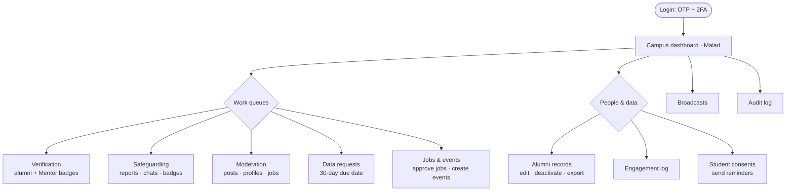
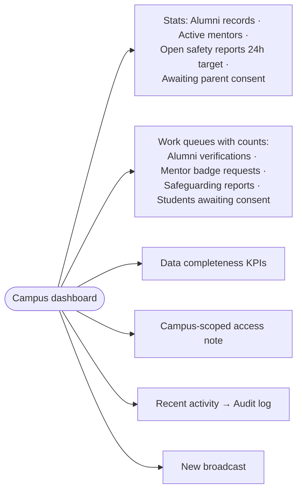
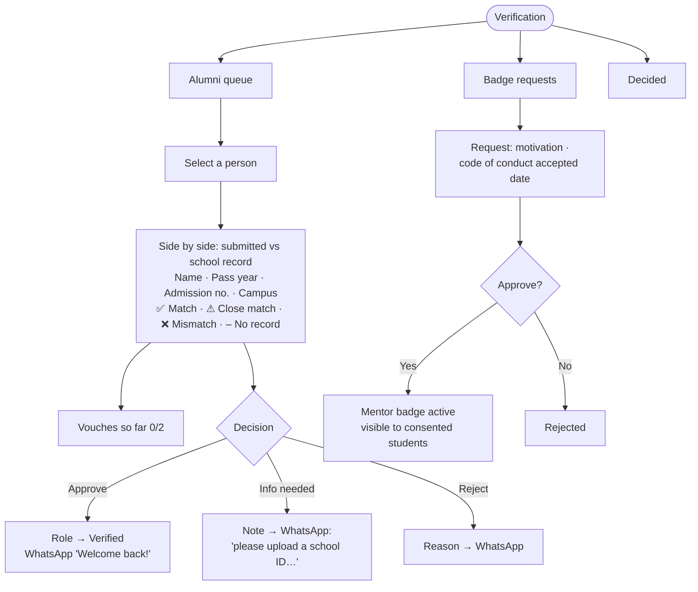
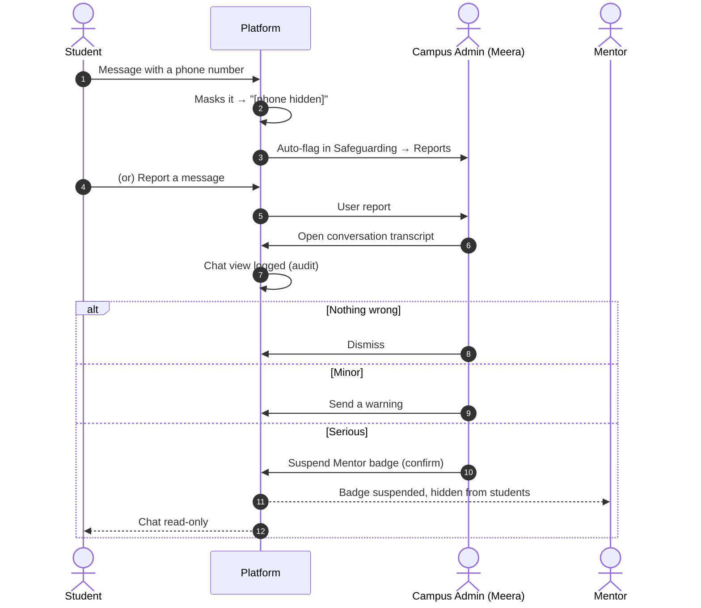
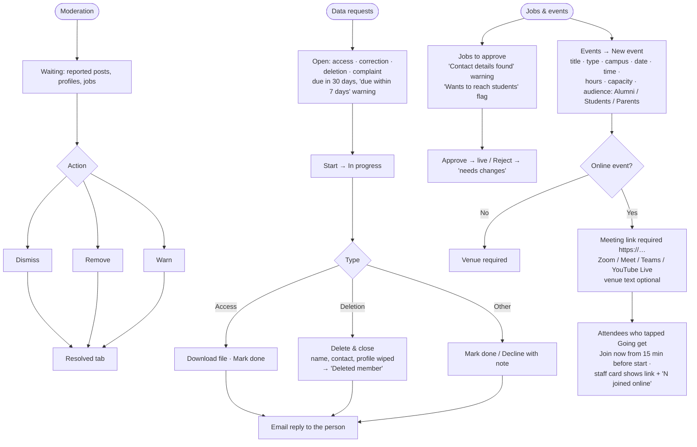
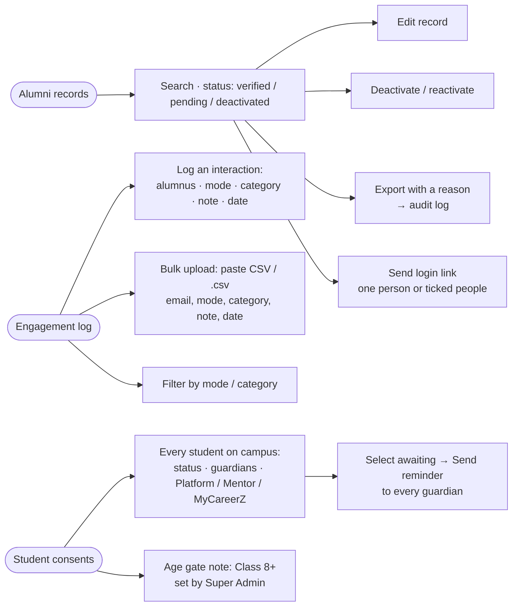
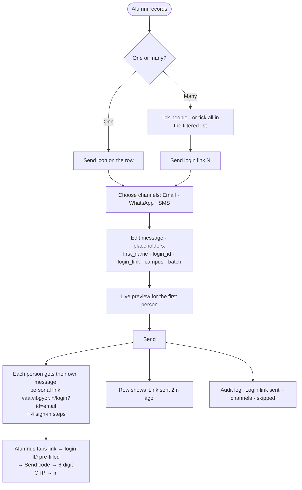
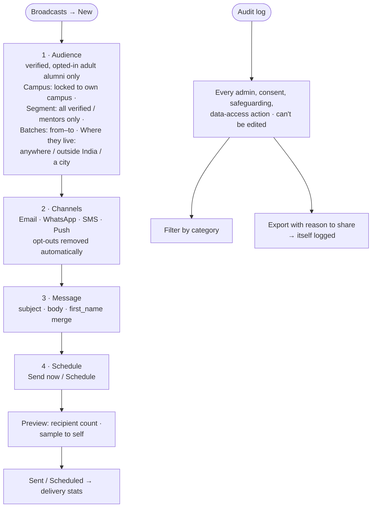

# VIBGYOR Alumni Platform: Campus Admin Flow

> Role code **CAD**. Built from the prototype source (`src/components/Homes.tsx` → `StaffDashboard`, `components/AppShell.tsx`, `components/admin.tsx` → `useScope`, `lib/store.tsx` → `can` and admin actions, `lib/data.ts` → `seedPermissions`, and every page under `app/portal/admin/`). Demo persona: **Meera Joshi (`cad1`)**, Campus Admin · Malad (pilot). See also [GAO-FLOW.md](GAO-FLOW.md) and [SAD-FLOW.md](SAD-FLOW.md).

---

## 1. What a Campus Admin is on the platform

| Item | Detail |
|---|---|
| Who | Alumni office staff for **one campus** |
| Login | OTP + **2-factor** |
| Scope | **Own campus only** (queues, records, reports, broadcasts, exports) |
| Main job | Keep the community verified and safe; run campus communication |

### Menu

| Section | Pages |
|---|---|
| — | **Dashboard** |
| Queues | **Verification** · **Safeguarding** · **Moderation** · **Data requests** · **Jobs & events** |
| People & data | **Alumni records** · **Engagement log** · **Student consents** |
| Communication | **Broadcasts** |
| Governance | **Audit log** |

Not for CAD: Duplicates, Master lists (GAO / SAD), Permissions, Settings (SAD).

### What a Campus Admin can do (default permissions)

| Capability | CAD | What it means |
|---|---|---|
| View alumni records | ✅ | Full record for own campus; every view logged |
| Edit or deactivate records | ✅ | Fix details, switch accounts off |
| Export data (with a reason) | ✅ | Reason recorded in the audit log |
| Approve alumni verification | ✅ | Approve / ask for info / reject; approve Mentor badges |
| Read student–mentor chats | ✅ | Open transcripts from Safeguarding (logged) |
| Send broadcasts | ✅ | Own campus audiences |
| Moderate reported content | ✅ | Posts, profiles, jobs |
| Handle data & privacy requests | ✅ | Access, correction, deletion, complaint |
| Log alumni interactions | ✅ | Engagement log, single or bulk CSV |
| Merge duplicates / edit master lists | ❌ | Group Alumni Office |

The Super Admin can change these live on **Permissions**.

### Fixed safety rules (no role can switch these off)

- Students see and contact only Mentor-badged alumni (CS-4)
- Contact details are masked in student chats (CS-6)
- Student chats can't be deleted by anyone (CS-5)
- Every staff view or export of student data is logged (CS-16)
- Staff accounts always use 2-factor login (A13)
- Campus Admins only see their own campus (A6)

---

## 2. Master flow



---

## 3. Flow 1: Dashboard



---

## 4. Flow 2: Alumni verification and Mentor badges



All decisions go to the audit log.

---

## 5. Flow 3: Safeguarding



| Tab | What's there |
|---|---|
| **Reports** | Auto-flags (masking) and user reports; show closed toggle |
| **Student conversations** | Every student–mentor chat on the campus; open transcript (masked parts highlighted) |
| **Mentor badges** | Every mentor; suspend or reinstate |

Target: respond within **24 hours**.

---

## 6. Flow 4: Moderation, data requests, jobs & events



---

## 7. Flow 5: Records, engagement, consents



### Sending a login link (onboarding)



| Rule | Detail |
|---|---|
| Who can send | Anyone with *Edit or deactivate records* (CAD, GAO, SAD by default) |
| Credentials | **No passwords are sent.** The message gives the login ID (registered email) and a link that pre-fills it; sign-in still needs the one-time code |
| Skipped | Deactivated people; WhatsApp / SMS skipped for people with no mobile (they still get email if chosen) |
| Pending alumni | Message adds: *"your campus is still verifying you. You can complete your profile meanwhile"* |
| Re-sending | Allowed; the modal warns how many were already sent a link; the row shows the latest time |
| SMS | Short version: first paragraph + `vaa.vibgyor.in/login` |

Default message:

```
Hi {{first_name}},

Your VIBGYOR Alumni Association profile ({{campus}}, Batch {{batch}}) is ready. Sign in here: {{login_link}}

How to sign in (no password needed):
1. Open the link above, or go to vaa.vibgyor.in/login
2. Your login ID is {{login_id}} (already filled in if you use the link)
3. Tap "Send code" and enter the 6-digit code we send you
4. Check your details, set your privacy, and say hello to your batch

We'll never ask for a password or the code over phone or email.

VIBGYOR Alumni Office
```

---

## 8. Flow 6: Broadcasts and audit log



Students and parents are never broadcast audiences.

---

## 9. Gaps and fixes

| # | Item | Status |
|---|---|---|
| 1 | Admin pages could be opened by any signed-in user who typed the URL | ✅ **Fixed.** Every `/portal/admin/*` page is wrapped in `AdminOnly` (CAD / GAO / SAD; the Engagement log also allows TCH). Others see *"Staff only"* |
| 2 | `verify`, `chats.read`, `broadcast.send`, `records.view` weren't checked | ✅ **Fixed.** Verification and badge decisions need `verify`; *View conversation* needs `chats.read`; *New broadcast* needs `broadcast.send`; Alumni records and the staff directory need `records.view`. Without the capability the page shows *"Your role can't …"* |
| 3 | Moderation of jobs is split: approval in *Jobs & events*, reports in *Moderation* | Open: link the two, or show reported jobs in Jobs & events |

---

## 10. Quick demo script

1. Log in as **Meera** (OTP + 2FA) → Campus dashboard · Malad.
2. **Verification** → pick a pending alumnus → compare fields → **Approve**.
3. **Badge requests** → approve a mentor.
4. As **Diya**, send a mentor a message with a phone number. As Meera → **Safeguarding** → auto-flag → open transcript → **Suspend badge**.
5. **Data requests** → Aarav's correction (in progress) → **Mark done**.
6. **Jobs & events** → approve a job → **New event** for students and parents.
7. **Student consents** → select students awaiting → **Send reminder**.
8. **Broadcasts** → audience *Batch 2016* → WhatsApp + email → preview → send.
9. **Audit log** → see every action above.
