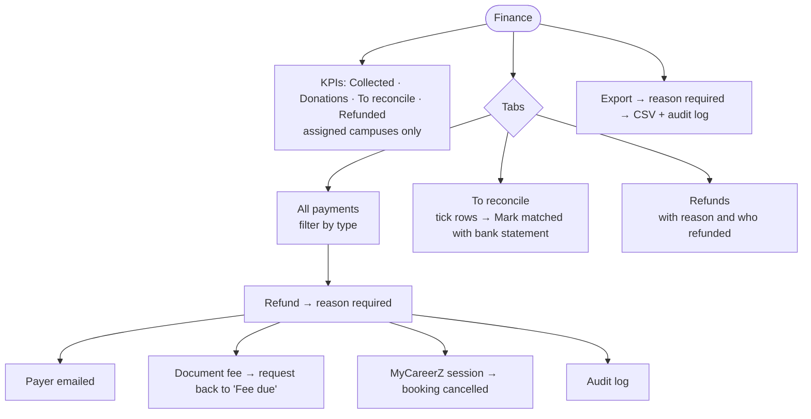
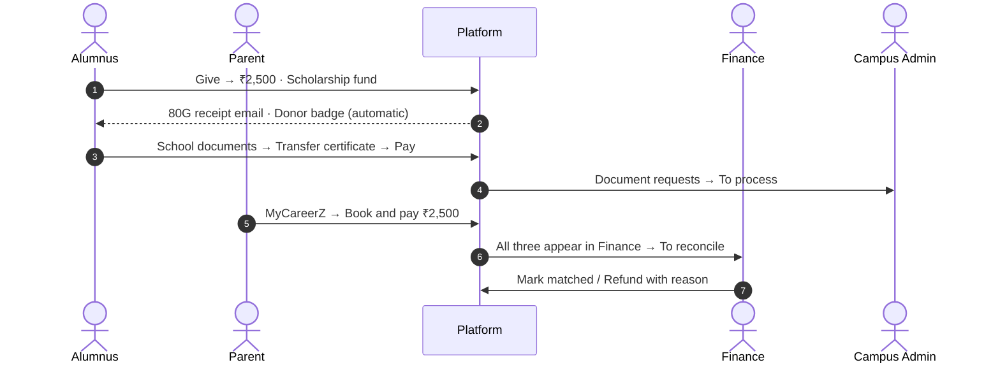

# VIBGYOR Alumni Platform: Finance & Commerce Flow

> Role code **FIN**. Built from the prototype source (`src/app/portal/finance/page.tsx`, `lib/store.tsx` → `donate`, `payDocument`, `bookMcz`, `refundPayment`, `reconcilePayments`; `lib/data.ts` → `seedPayments`, `HARD_LIMITS`). Demo persona: **Kavita Rao (`fin1`)**, Finance · Malad and Goregaon West.

> Payments are simulated ("demo payment"); in production they come from the payment gateway.

---

## 1. What Finance & Commerce is on the platform

| Item | Detail |
|---|---|
| Who | Accounts staff, created by the Super Admin in *Staff & scopes* |
| Scope | **Assigned campuses only** (any set, chosen by the Super Admin) |
| Login | Email or mobile + one-time code + 2-factor |
| Menu | **Home** · **Finance** |
| Capabilities | `finance.view`, `finance.refund` (guard rail: only FIN and SAD can ever refund) |
| Never sees | Directory, student data, chats |

### What money flows through the platform

| Payment | Who pays | Rule (Annex B) |
|---|---|---|
| Donation | Verified or pending alumni | cond. 16: ALP may donate. cond. 15: **parents cannot donate** |
| Document fee | Alumni requesting a certificate | cond. 14: Finance holds the fee; campus only starts after payment |
| MyCareerZ session | **Parent** (full booking) | cond. 17: needs the parent's MyCareerZ consent |

---

## 2. Finance page

| Action | Who | Rules enforced |
|---|---|---|
| See payments | FIN (own campuses), SAD (all) | `finance.view`; GAO only if the Super Admin grants it |
| Refund | FIN (own campuses), SAD | `finance.refund`; reason ≥ 5 characters; can't refund twice |
| Reconcile | FIN (own campuses), SAD | `finance.refund` |
| Export | FIN, SAD | Reason recorded (cond. 24/25) |

---

## 3. Flows that create payments

---

## 4. Demo script

1. Log in as **Kavita Rao** → Finance. You see Malad and Goregaon West payments only.
2. **To reconcile** → tick two rows → *Mark matched*.
3. **All payments** → Refund the MyCareerZ session → reason. Log in as **Aditya Bhatt** (MyCareerZ): the booking shows *Cancelled*.
4. Export → enter a reason → CSV downloads; Audit log shows the export.
5. As the Super Admin, open Permissions: the *Refund* row is locked 🔒 for every role except Finance and Super Admin.

## 5. Open questions for production

| # | Question |
|---|---|
| 1 | Payment gateway and settlement file format for automatic reconciliation |
| 2 | Form 10BD export format and 80G receipt numbering |
| 3 | Credit notes for partial refunds |
