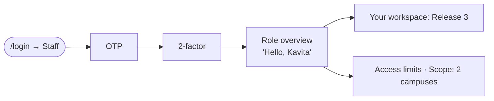
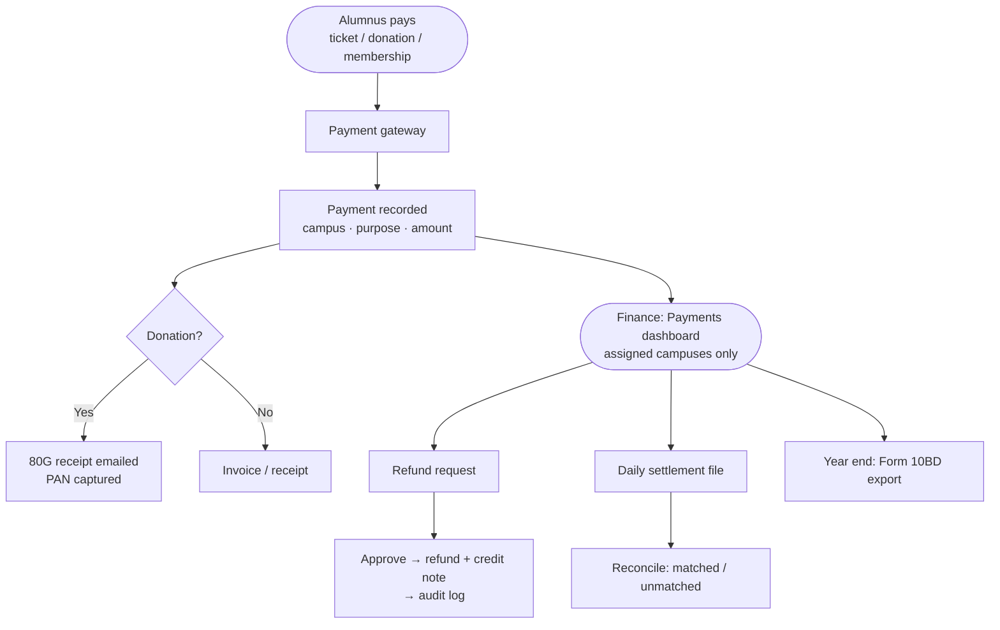

# VIBGYOR Alumni Platform: Finance & Commerce Flow

> Role code **FIN**. Built from the prototype source (`src/components/Homes.tsx` → `RoleOverview` / `roleFeatures.FIN`, `components/AppShell.tsx`, `lib/data.ts` → `seedPermissions`). Demo persona: **Kavita Rao (`fin1`)**, Finance · Malad and Goregaon West.

> ⚠️ **Prototype status:** Finance sees a **role overview** only. Payments arrive in **Release 3**. This file shows what is built today and the planned flow.

---

## 1. What Finance & Commerce is on the platform

| Item | Detail |
|---|---|
| Who | Finance team handling money flowing through the platform |
| Login | OTP + **2-factor** |
| Scope | **Only campuses assigned by the Super Admin** (demo: 2 campuses) |
| Menu (today) | **Home** only (role overview) |
| Capabilities (default matrix) | None of the admin capabilities |

### Built today

| # | What |
|---|---|
| 1 | Sign in with OTP + 2-factor |
| 2 | Role overview: planned workspace, access limits, campus scope |

### Planned workspace (Release 3)

| Feature | Purpose |
|---|---|
| Payments dashboard | Event tickets, membership, merchandise, donations |
| 80G receipts & Form 10BD export | Tax receipts for donations; annual donor statement |
| Refunds with credit notes | Controlled refunds with an audit trail |
| Settlement reconciliation | Match gateway settlements to payments |

### Access limits

- ✅ Only campuses assigned by the Super Admin
- ❌ No alumni directory
- ❌ No student data
- ❌ No verification, safeguarding, broadcasts or moderation
- ✅ 2-factor login

---

## 2. Flow 1: Login (built)

---

## 3. Flow 2: Planned payments flow

---

## 4. Open questions for Release 3

| # | Question |
|---|---|
| 1 | Which payment gateway, and who owns the merchant account (group or per campus)? |
| 2 | Which purposes take money in Release 3: events, donations, membership, merchandise? |
| 3 | Who approves refunds, and is there an amount limit? |
| 4 | Does Finance need any alumni contact data (e.g. donor name and PAN only)? |
