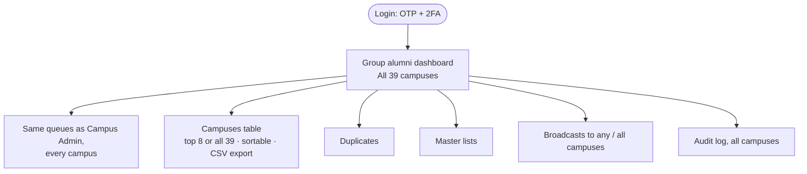
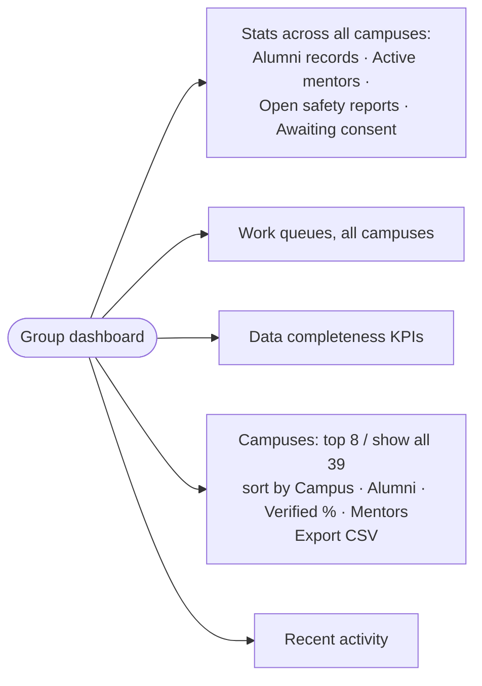
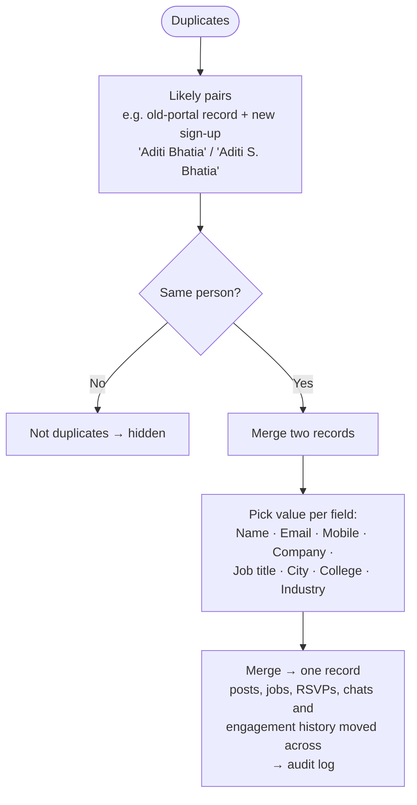
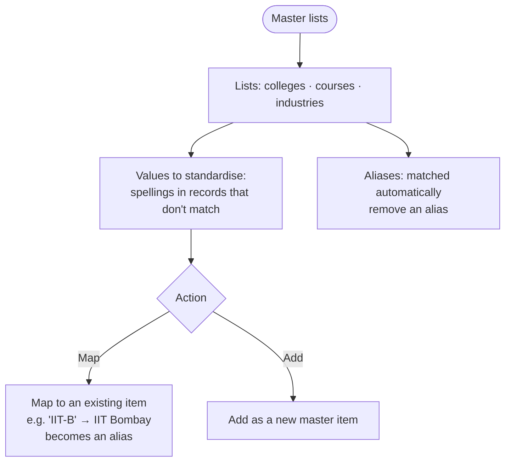
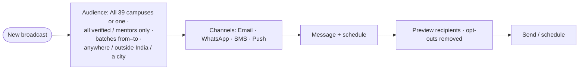

# VIBGYOR Alumni Platform: Group Alumni Office Flow

> Role code **GAO**. Built from the prototype source (`src/components/Homes.tsx` → `StaffDashboard` / `CampusTable`, `components/AppShell.tsx`, `components/admin.tsx` → `useScope`, `lib/data.ts` → `seedPermissions`, `app/portal/admin/duplicates`, `masters` and the shared admin pages). Demo persona: **Sanjay Verma (`gao1`)**, Group office · all 39 campuses. See [CAD-FLOW.md](CAD-FLOW.md) for the shared admin pages in detail.

---

## 1. What the Group Alumni Office is on the platform

| Item | Detail |
|---|---|
| Who | Central alumni team for the whole VIBGYOR group |
| Login | OTP + **2-factor** |
| Scope | **All 39 campuses** |
| Main job | Everything a Campus Admin does, across every campus, plus data quality (duplicates, master lists) and group-wide communication |

### Menu

| Section | Pages |
|---|---|
| — | **Dashboard** (group) |
| Queues | Verification · Safeguarding · Moderation · Data requests · Jobs & events |
| People & data | Alumni records · Engagement log · Student consents · **Duplicates** · **Master lists** |
| Communication | Broadcasts (all campuses) |
| Governance | Audit log |

### GAO vs Campus Admin

| Capability | CAD | GAO |
|---|---|---|
| Scope | Own campus | **All 39 campuses** |
| View / edit / export records | ✅ | ✅ |
| Approve verification + Mentor badges | ✅ | ✅ |
| Read student–mentor chats | ✅ | ✅ |
| Send broadcasts | Own campus | **Any campus or all** |
| Moderate content | ✅ | ✅ |
| Handle data requests | ✅ | ✅ |
| Log interactions | ✅ | ✅ |
| **Merge duplicate records** | ❌ | ✅ |
| **Edit master lists** | ❌ | ✅ |
| Permissions, Settings | ❌ | ❌ (Super Admin) |

---

## 2. Master flow

---

## 3. Flow 1: Group dashboard

---

## 4. Flow 2: Duplicate records

*"People who seem to have two records, for example one from the old portal and one from signing up again."*

---

## 5. Flow 3: Master lists

*"One agreed spelling for every college, course and industry, so search, filters and reports add up."*

---

## 6. Flow 4: Group broadcast

Only verified, opted-in adult alumni are reachable.

---

## 7. Shared admin flows

Verification, safeguarding, moderation, data requests, jobs & events, records, engagement log, student consents and audit log work as in [CAD-FLOW.md](CAD-FLOW.md) sections 4–8, with **every campus** in scope and a campus filter where relevant.

---

## 8. Gaps and fixes

| # | Item | Status |
|---|---|---|
| 1 | Admin pages had no role guard | ✅ **Fixed** (see [CAD-FLOW.md](CAD-FLOW.md) section 9) |
| 2 | `verify`, `chats.read`, `broadcast.send`, `records.view` weren't enforced | ✅ **Fixed** (CAD section 9) |
| 3 | The Campuses table only showed the top 8 | ✅ **Fixed.** *Show all 39 campuses*, click any column heading to sort, *Export CSV* downloads all 39 |

---

## 9. Quick demo script

1. Log in as **Sanjay** → Group alumni dashboard → Campuses table.
2. **Duplicates** → *Aditi Bhatia* / *Aditi S. Bhatia* → **Merge** → pick fields → merge.
3. **Master lists** → a value to standardise → **map** to an existing college.
4. **Data requests** → deletion request → **Delete & close** → person shows as *Deleted member* in Alumni records.
5. **Broadcasts** → audience *All 39 campuses · Outside India* → send.
