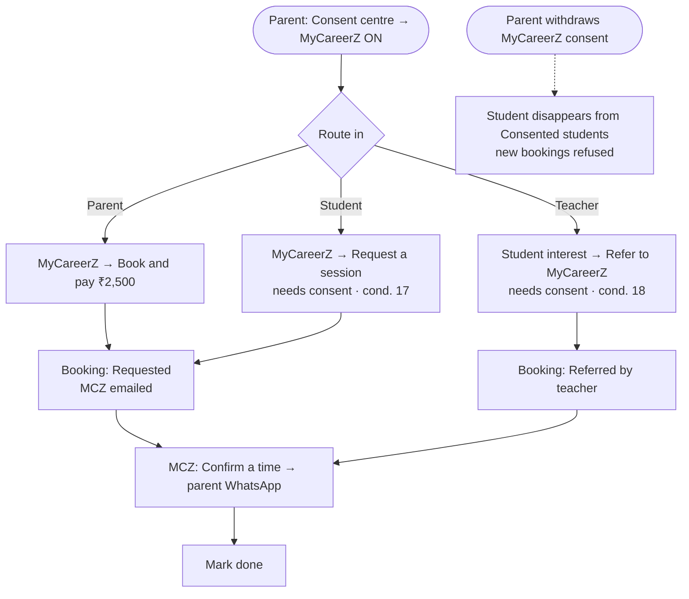

# VIBGYOR Alumni Platform: MyCareerZ Counsellor Flow

> Role code **MCZ**. Built from the prototype source (`src/app/portal/mcz/page.tsx`, `app/portal/careers/page.tsx`, `app/portal/teacher/interest/page.tsx`, `lib/store.tsx` → `bookMcz`, `referToMcz`, `updateBooking`, `logView`). Demo persona: **Aditya Bhatt (`mcz1`)**, MyCareerZ · Malad, Goregaon West, Goregaon East. See also [PARENT-FLOW.md](PARENT-FLOW.md).

---

## 1. What a MyCareerZ counsellor is on the platform

| Item | Detail |
|---|---|
| Who | Counsellor from MyCareerZ, created by the Super Admin under the data-sharing agreement |
| Scope | **Assigned campuses only** (set in *Staff & scopes*) |
| Menu | **Home** · **MyCareerZ** |
| Capability | `mcz.students` (guard rail: no other role can ever have it) |

| Annex B condition | How the prototype enforces it |
|---|---|
| 4 · opted-in alumni guides | *Alumni guides* lists only alumni who ticked *Be a MyCareerZ alumni guide* (My badges) |
| 7 · consented students only | *Consented students* lists only active students on own campuses with MyCareerZ consent |
| 12 · webinars | *New webinar*: own campuses only, audience students + parents; the store refuses anything else |
| 19 · manages bookings | Confirm a time (parents get WhatsApp) · Mark done |
| 26 · own funnel only | *My funnel* counts only own campuses and own webinars |
| CS-16 · every view logged | Opening a student writes a `data_access` audit entry |

---

## 2. How a student reaches MyCareerZ

---

## 3. Counsellor workspace

| Tab | What's there |
|---|---|
| Bookings | Referred and requested sessions, who booked or referred, paid or not, teacher's note |
| Consented students | Name, class, campus → *Open* shows 3C choices and interests (logged). No contact details |
| Alumni guides | Opted-in alumni with course · college · country |
| Webinars | Create a webinar with a meeting link; appears in students' and parents' Events with *Join now* |
| My funnel | Consented → referred → requested → confirmed/done, own data only |

## 4. Demo script

1. **Aditya Bhatt** → MyCareerZ → Bookings: Ishita (paid by parent, confirmed) and Zara (referred by Mrs. Fernandes).
2. Confirm Zara's time → WhatsApp to Zara's parent (Farhan Sheikh) appears in the device simulator.
3. Consented students → *Open* Ishita → Audit log shows the view.
4. As **Mrs. Fernandes** (teacher): *Refer to MyCareerZ* a student without consent → refused with the reason.
5. As **Lakshmi Iyer** (parent, `par2`): MyCareerZ → switched off → Consent centre → switch on → book.

## 5. Open questions

| # | Question |
|---|---|
| 1 | Which student fields MyCareerZ may see (agreed field list in the data-sharing agreement) |
| 2 | Session fee and whether students can book free sessions |
