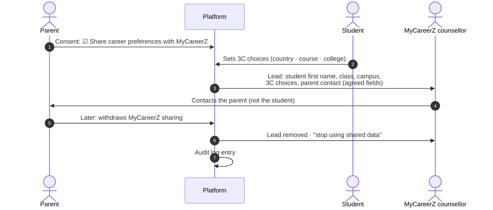
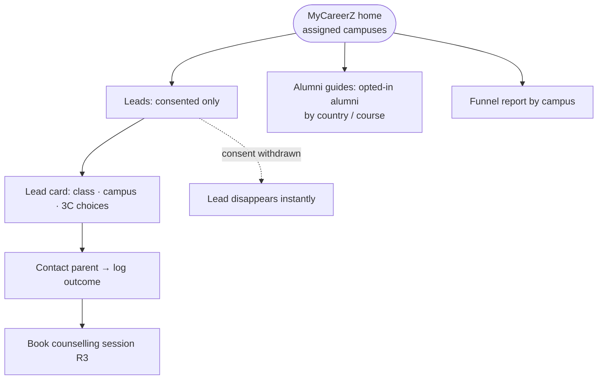

# VIBGYOR Alumni Platform: MyCareerZ Counsellor Flow

> Role code **MCZ**. Built from the prototype source (`src/components/Homes.tsx` → `RoleOverview` / `roleFeatures.MCZ`, `lib/data.ts` → `consentPurposes.mcz` / `seedPermissions`, `app/portal/consent/page.tsx`). Demo persona: **Aditya Bhatt (`mcz1`)**, MyCareerZ · Malad, Goregaon West, Goregaon East. See also [PARENT-FLOW.md](PARENT-FLOW.md).

> ⚠️ **Prototype status:** the MyCareerZ counsellor sees a **role overview** only. Parent consent for MyCareerZ sharing **is** built. This file shows what is built today and the planned flow.

---

## 1. What a MyCareerZ counsellor is on the platform

| Item | Detail |
|---|---|
| Who | Counsellor from **MyCareerZ**, VIBGYOR's career-counselling service |
| Login | OTP + **2-factor** |
| Scope | **Campuses assigned by the Super Admin** (demo: 3) |
| Data | **Consented records and agreed fields only** |
| Menu (today) | **Home** only (role overview) |
| Capabilities (default matrix) | None of the admin capabilities |

### Built today

| # | What | Where |
|---|---|---|
| 1 | Sign in with OTP + 2-factor | `/login` |
| 2 | Role overview: planned workspace, limits, scope | `/portal` |
| 3 | Parent gives or withdraws **MyCareerZ sharing** per child | Parent consent page / Consent centre |

What the parent agrees to: *"Send your child's course, country and college preferences and any enquiry to MyCareerZ, VIBGYOR's career-counselling service, so a counsellor can contact you (the parent). No advertising is shown to your child."*

On withdrawal: *"We stop sharing with MyCareerZ straight away and tell MyCareerZ to stop using the data already shared."*

### Planned workspace

| Feature | Purpose |
|---|---|
| Consented leads in real time | Students whose parent allowed MyCareerZ sharing |
| Opted-in alumni guides | Alumni who agreed to help MyCareerZ |
| Funnel reports by campus | Leads → contacted → counselled |
| Counselling bookings (R3) | Book sessions with parents |

### Access limits

- ✅ Consented records and agreed fields only (3C preferences, enquiry, parent contact)
- ✅ Sharing stops the moment consent is withdrawn
- ✅ Contact goes to the **parent**, never the student
- ❌ No alumni directory, no student–mentor chats, no other student data
- ✅ 2-factor login

---

## 2. Flow 1: How a lead reaches MyCareerZ

---

## 3. Flow 2: Planned counsellor workspace

---

## 4. Gaps and open questions

| # | Item |
|---|---|
| 1 | Workspace not built; consent side is built |
| 2 | Agree the exact fields shared (e.g. parent mobile or email only?) |
| 3 | How MyCareerZ confirms it deleted data after withdrawal |
| 4 | How alumni opt in as MyCareerZ guides (profile setting?) |
