# VIBGYOR Alumni Platform: Parent / Guardian Flow

> Role code **PAR**. Built from the prototype source (`src/components/Homes.tsx` → `ParentHome`, `app/consent/[studentId]/ConsentClient.tsx`, `app/portal/consent/page.tsx`, `components/MyData.tsx`, `app/portal/events/page.tsx`, `components/AppShell.tsx`). Demo personas: **Neha Mehta (`par1`)**, mother of **Aarav Mehta (`stu1`)** and **Riya Mehta (`stu3`)**; **Rohit Mehta (`par3`)**, father and second guardian (see section 12).

---

## 1. What a parent is on the platform

| Item | Detail |
|---|---|
| Who | Parent or legal guardian of a student in Class 8 to 12 |
| Why the role exists | DPDP Act 2023: a minor's account needs **verified parental consent** before it is switched on |
| Sign-up | **None.** The school creates the parent record from ERP data (mobile / email already on file) |
| Login | One-time code (OTP) to the **school-registered** mobile or email. No password |
| Scope | **Own children only** (`childIds`). One parent can have more than one child |
| Menu | **Home** · **Consent centre** · **Mentor chats** · **Events** |

### What a parent can do

| # | Action | Where |
|---|---|---|
| 1 | Receive the consent request (SMS + WhatsApp + email) | Phone / inbox |
| 2 | Verify identity with a 6-digit OTP | `/consent/<studentId>` |
| 3 | Give consent per purpose: **Platform use** (required), **Mentor contact**, **MyCareerZ sharing** | `/consent/<studentId>` |
| 4 | See each child's status and permissions at a glance | `/portal` (Parent home) |
| 5 | Turn any permission on or off later, with immediate effect | `/portal/consent` |
| 6 | See the consent history (who, when, channel, OTP ref, notice version) | `/portal/consent` → History |
| 7 | Download the child's data (text file) | Consent centre → *"<Child>'s data"* card |
| 8 | Ask for a correction, deletion, or raise a privacy complaint | Consent centre → *"<Child>'s data"* card |
| 9 | Browse and RSVP to parent events, add to calendar | `/portal/events` |
| 10 | **Read each child's mentor conversations, join them to message the mentor**, and report a message | `/portal/child-chats` |

### What a parent cannot do

- ❌ See the alumni directory, alumni profiles, batch groups or chats
- ❌ Start a new conversation with a mentor (only the child can; the parent joins the child's existing ones)
- ❌ Message alumni who aren't the child's mentor, or browse alumni
- ❌ See jobs / internships
- ❌ See other students or other families
- Opening any of these pages shows *"Not available for your account"*.

---

## 2. Master flow (end to end)

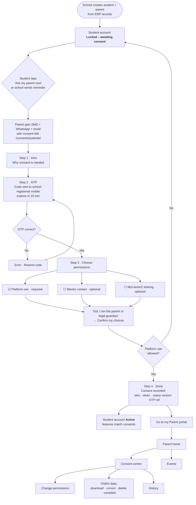

---

## 3. Flow 1: Login

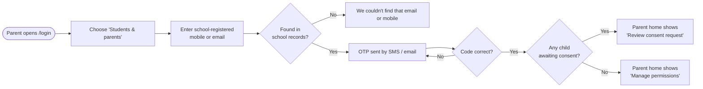

> Parents never sign up. Callout on login: *"Students and parents don't need to sign up. Your school creates your account from school records."*

---

## 4. Flow 2: Giving consent (student activation)

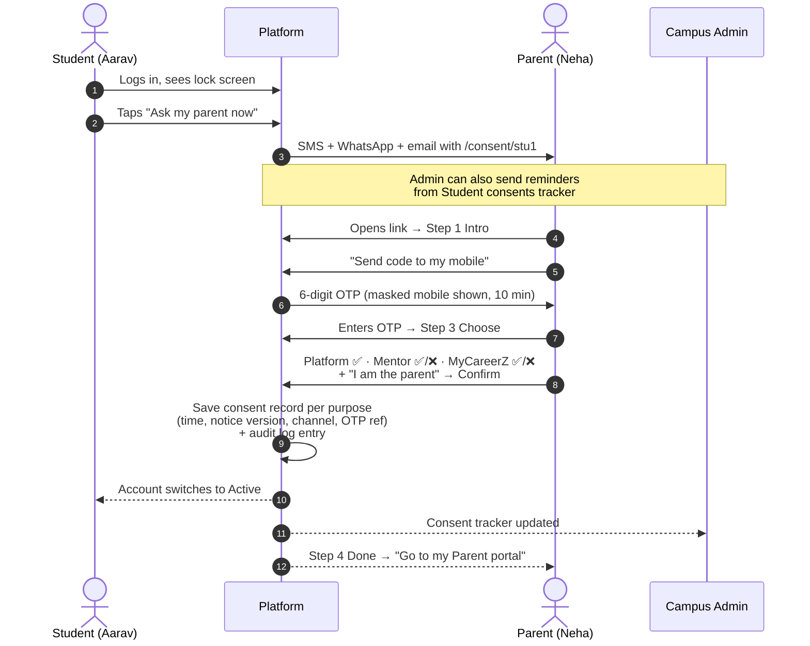

### What each permission unlocks for the child

| Permission | Required | Child gets | If not given |
|---|---|---|---|
| **Platform use** | ✅ Yes | Sign in, guidance content, events, internships | Account stays **Locked** |
| **Mentor contact** | Optional | *Find a mentor* + safe messaging with Mentor-badged alumni | Mentor pages show "Ask your parent to switch this on" |
| **MyCareerZ sharing** | Optional | Course / country / college preferences sent to MyCareerZ; counsellor contacts the **parent** | Nothing shared |

> Mentor contact and MyCareerZ can only be on when Platform use is on.

---

## 5. Flow 3: Parent home (dashboard)

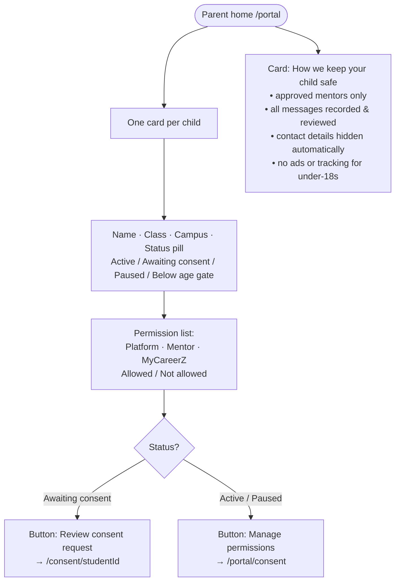

---

## 6. Flow 4: Changing or withdrawing permissions (Consent centre)

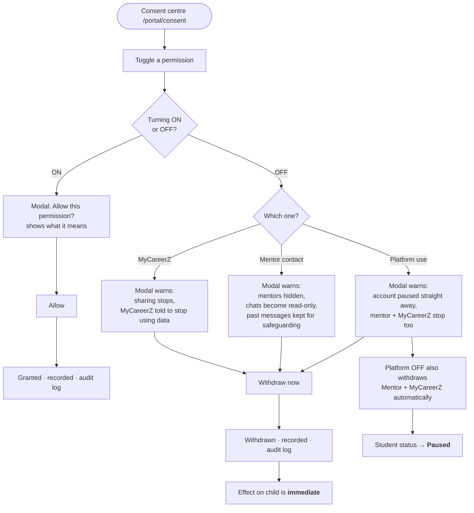

| Withdrawn | Effect on the child (immediate) |
|---|---|
| Platform use | Account **Paused**; can't sign in; mentor + MyCareerZ also switched off |
| Mentor contact | Mentors disappear from search; existing chats **read-only**; history kept |
| MyCareerZ sharing | No more data sent; MyCareerZ told to stop using data already shared |

Every change shows in **History** with time, channel and OTP reference.

---

## 7. Flow 5: Child's data and privacy requests (DPDP)

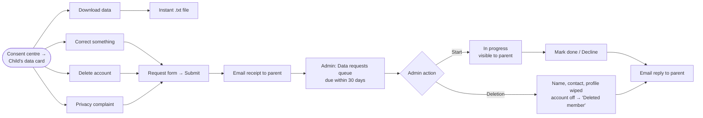

---

## 8. Flow 6: Events

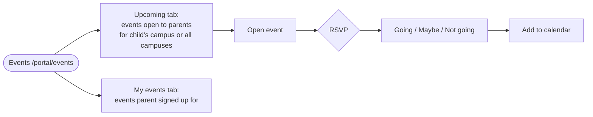

Example parent events: *Career talk: commerce after Class 12* (students + parents, Malad), *Studying in the UK: alumni panel* (alumni, students, parents, all campuses).

**Online events: Join now.** Online events (webinars) show a **Join now** button next to the RSVP buttons:

| When | Button |
|---|---|
| More than 15 min before start | Disabled: *Join opens in 2 days 4 h* (counts down by itself) |
| From 15 min before start until the end | **Join now** (green), only if you tapped **Going**; otherwise *Tap "Going" to join* |
| While running | Red **Live now** tag on the card |
| After the end | *Ended* |
| Student without parent consent | Disabled |

Pressing **Join now** records attendance and opens the webinar room link. Students' camera and mic stay off; questions go through moderated chat. Staff see *N joined online* on **Jobs & events**. Demo: a *"Live now: Ask an engineer working abroad"* webinar is created fresh on every demo reset, so Join now can be tried straight away (Diya and Lakshmi are already registered).

---

## 8a. Flow 7: The child's mentor chats (read and join)

Parents can **read** every conversation their child has with an alumni mentor and **join** it to message the mentor themselves. A parent's message goes into the **same conversation**, so the child, the mentor and the campus alumni office all see it. Parents can't start a new conversation; only the child can.

```mermaid
flowchart TD
    A([Mentor chats /portal/child-chats<br/>or Parent home → 'Mentor chats N']) --> B{2+ children?}
    B -- Yes --> C[Child tabs with conversation counts]
    B -- No --> D[Conversation list]
    C --> D
    D --> E[Mentor name · topic · last message ·<br/>'contact details hidden' tag]
    E --> F[Open conversation<br/>Aarav · mentor · You, each labelled]
    F --> G[Audit log: 'Parent viewed mentor conversation']
    F --> H{Can write?}
    H -- Account active + Mentor contact on +<br/>badge active --> I[Type a message<br/>live warning for phone / email / link]
    I --> J[Sent into the same conversation<br/>contact details hidden · auto-flag to campus]
    J --> K[Mentor gets a push:<br/>'New message from Neha Mehta (Aarav's parent)']
    K --> L[Mentor replies in the same thread]
    L --> M[Parent gets a push:<br/>'[Aarav · Class 11] Priya replied…']
    H -- Otherwise --> N[Read-only, with the reason]
    F --> O[Report a message → Campus Safeguarding<br/>'Parent report: …']
```

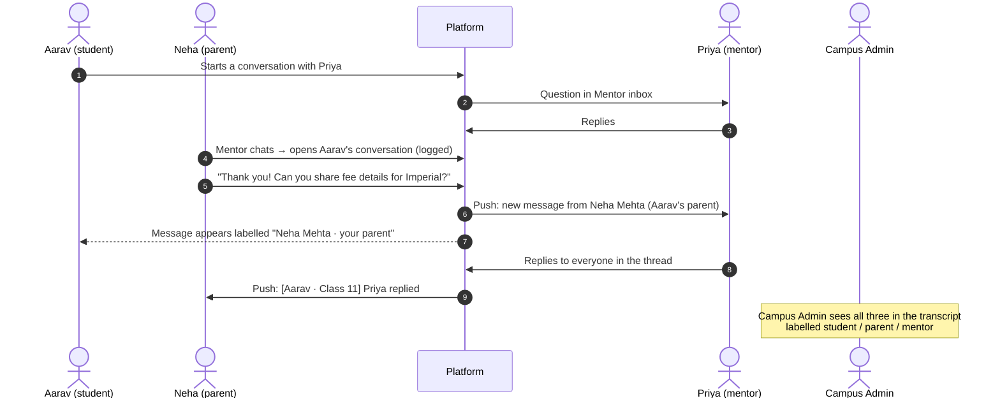

| Rule | Detail |
|---|---|
| Where the parent writes | In the child's existing conversation. **Can't start** a new one (only the child can) |
| Who sees a parent's message | The child, the mentor, the campus alumni office (and the other guardian, if they open it) |
| Labels | Parent view: *You* / *Aarav* / mentor name. Student view: *Neha Mehta · your parent*. Mentor view: *Neha Mehta · Aarav's parent*. Campus transcript: *parent* |
| Masking | Same as everyone: phone, email, links, @handles hidden; a masked message raises a safeguarding auto-flag |
| Read-only when | Child's account paused · Mentor contact switched off · mentor badge suspended (same as the child) |
| Notifications | Parent writes → push to the mentor. Mentor writes → push to any parent who has joined that conversation |
| Report | Any message from the mentor or child; goes to Safeguarding as *Parent report* |
| Deleting | Not possible for anyone |
| Logging | Each conversation a parent opens → audit log (*data access*); every message is stored like any other |
| Transparency | Consent text, student banner, mentor banner and mentor code of conduct all say parents can read **and join** |

Demo: log in as **Lakshmi Iyer** (`9819377421`, Diya's mother) → **Mentor chats** → Diya's conversation with Priya → send a message → switch to **Priya**: Mentor inbox shows it labelled *Lakshmi Iyer · Diya's parent* → reply → switch to **Diya**: she sees both. Try typing a phone number as the parent: it's hidden and Meera gets a safeguarding auto-flag.

---

## 8b. Flow 8: MyCareerZ sessions

Menu **MyCareerZ** (tab per child). With MyCareerZ consent ON the parent can **Book and pay ₹2,500** (demo payment); the MyCareerZ counsellor confirms a time and the parent gets a WhatsApp starting `[Child · Class N]`. With consent OFF the page links to the Consent centre. Parents **cannot donate** (Give is closed to them, cond. 15) but can buy services like this.

---

## 9. Student status lifecycle (driven by the parent)

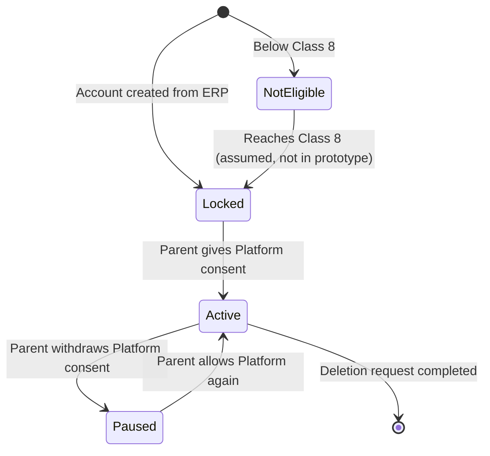

---

## 10. Data recorded for every consent action

| Field | Example |
|---|---|
| Student | Aarav Mehta (`stu1`) |
| Given by | Neha Mehta (`par1`) |
| Purpose | `platform` / `mentor` / `mcz` |
| Status | granted / withdrawn |
| Time | given at / withdrawn at |
| Channel | SMS / WhatsApp / email |
| OTP reference | e.g. `OTP-xxxx` |
| Notice version | `NOTICE_VERSION` in force at the time |

Also written to the **Audit log** (category `consent`), visible to Campus Admin / Group Alumni Office / Super Admin.

---

## 11. Quick demo script

1. Log in as **Aarav** → **Ask my parent now**.
2. Device simulator → **Open consent link**.
3. **Send code to my mobile** → enter / autofill OTP.
4. Switch on **Talk to approved alumni mentors**, tick **I am Aarav's parent**, **Confirm my choices**.
5. **Go to my Parent portal** → Parent home shows Aarav **Active**.
6. **Consent centre** → switch off **Mentor contact** → **Withdraw now**. Aarav loses mentor access immediately.
7. **Aarav's data** card → **Download data** or raise a request.
8. **Events** → RSVP to a parent event.

Alternate login: `9820045210` or `neha.mehta@example.com` (SMS OTP).

---

## 12. Parent with two (or more) children

> **Note:** All of this section, with its diagram and layout sketch, was added after a review of the multi-child case. **Riya Mehta started as a made-up name for the example.** She has since been added to the demo data as fictional sample student `stu3`, so the case can be shown live.

### 12.1 Demo family

| ID | Name | Role | Detail |
|---|---|---|---|
| `par1` | Neha Mehta | Parent | Mother · `childIds: [stu1, stu3]` |
| `par3` | Rohit Mehta | Parent | Father · **second guardian** · `childIds: [stu1, stu3]` |
| `stu1` | Aarav Mehta | Student | Class 11 · **Malad** (`c01`) · awaiting consent · `parentIds: [par1, par3]` |
| `stu3` | Riya Mehta | Student | Class 8 · **Goregaon West** (`c02`) · awaiting consent · `parentIds: [par1, par3]` |

Event `ev5` *"Class 8 parents: choosing subjects for Class 9"* is open to students and parents at **Goregaon West only**, to show the multi-campus events fix.

### 12.2 What a parent with two children sees

**One login covers every child.** There is no separate account per child and no "pick a child" step.

| Screen | What Neha sees |
|---|---|
| **Login** | One OTP to her school-registered mobile, same as with one child |
| **Parent home** `/portal` | Banner: *"2 of your children are waiting for your permission · Review for Aarav · Review for Riya"*. Then **one card per child** side by side, each with its own status, its own 3 permissions and its own button (*Review consent request for Riya* / *Manage Aarav's permissions*) |
| **Consent link** `/consent/<studentId>?p=<parentId>` | **One link per child, per guardian.** Each needs its own OTP and its own choices. Saying yes for Aarav does **not** switch on Riya |
| **Consent centre** `/portal/consent` | **Child tabs** at the top: `Aarav ● │ Riya ●` (dot = waiting for consent). Only one child shows at a time: *Permissions for Riya*, *Riya's data*, *History for Riya*. Opens on the child named in `?child=`, otherwise the first child who is waiting |
| **Confirm box** | Names the child: *"Withdraw this permission for Riya?"* with Riya's photo, class and campus |
| **Events** | Events for **every child's campus** (Malad + Goregaon West) plus all-campus events. Campus events are tagged *"For Riya's campus"* |
| **Messages** | Every SMS / WhatsApp / email starts with the child's name and class, e.g. `[Riya · Class 8]` |

With one child, the screens look as before (no tabs, no tags).

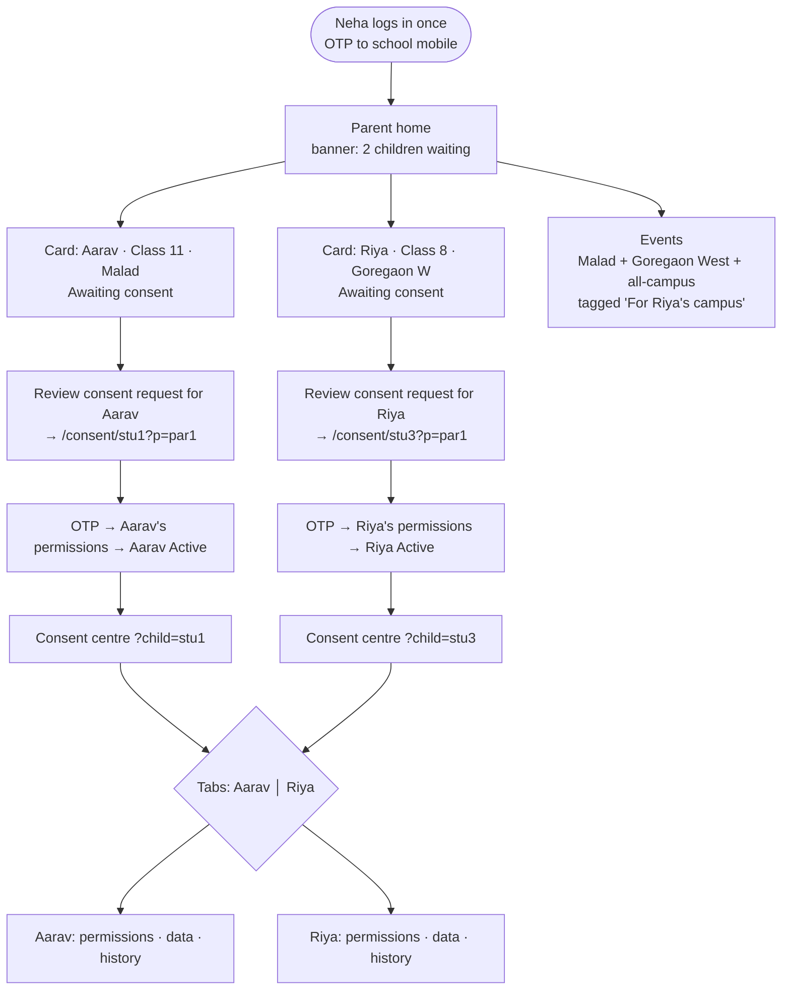

### 12.3 Two guardians (mother and father)

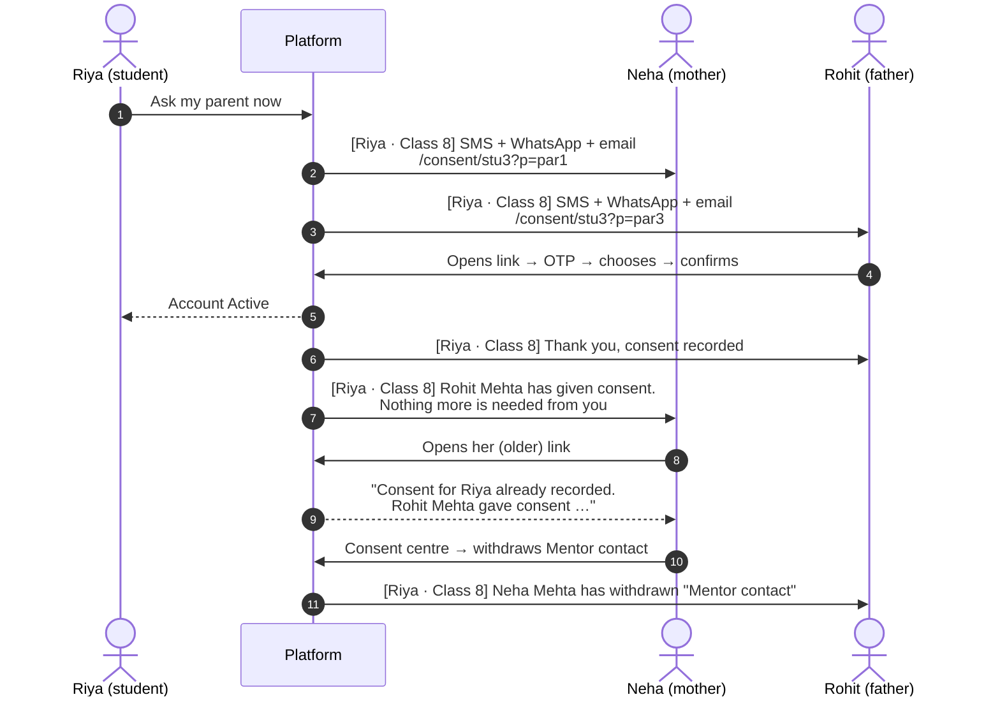

- Every guardian on record gets the request. **The first one to verify and confirm counts.**
- Either guardian can change permissions later. Both get a WhatsApp saying who changed what.
- Consent records store **who gave it** (`givenBy`), so the history always says which guardian acted.
- The student lock screen says *"Consent request sent to Neha Mehta and Rohit Mehta"*.
- The admin **Student consents** tracker lists every guardian per student.

### 12.4 Problems found and fixed

| # | Problem | Fix (prototype) | Files |
|---|---|---|---|
| 1 | No demo parent had two children (Neha only had Aarav, Lakshmi only had Diya), so the case couldn't be shown | Added **Riya Mehta** (`stu3`, Class 8, Goregaon West) as Neha's second child. Demo data version bumped to 6, so old browser data resets | `lib/data.ts` |
| 2 | The Consent centre stacked every child on one long page, so it was easy to change the wrong child's permissions | **Child tabs** (with a dot for "waiting"). One child shown at a time; headings and confirm box name the child | `app/portal/consent/page.tsx`, `components/ui.tsx` (`Tabs` dot) |
| 3 | Events used only the parent's own campus, so events at a second child's campus were missed | Events cover **all children's campuses**, tagged *"For Riya's campus"* | `app/portal/events/page.tsx` |
| 4 | Only the first parent on record got the consent link, so a second guardian couldn't give consent | Request goes to **every guardian**; link carries `?p=<parentId>`; first to confirm counts; others are told; added **Rohit Mehta** (`par3`) | `lib/store.tsx`, `app/consent/[studentId]/ConsentClient.tsx`, `components/Homes.tsx`, `app/portal/admin/consents/page.tsx` |
| 5 | Messages to parents didn't name the child clearly | Every consent message starts with `[Child · Class N]` (helper `childTag`) | `lib/utils.ts`, `lib/store.tsx` |

### 12.5 Layout

```
┌─ Parent home ───────────────────────────────────────────────┐
│ Welcome, Neha                                               │
│ ⚠ 2 of your children are waiting for your permission        │
│   Review for Aarav · Review for Riya                        │
│                                                             │
│ ┌ Aarav · Class 11 · Malad ─┐  ┌ Riya · Class 8 · Gor. W ─┐ │
│ │ ● Awaiting consent        │  │ ● Awaiting consent       │ │
│ │ Platform use  Not allowed │  │ Platform use  Not allowed│ │
│ │ Mentor contact Not allowed│  │ Mentor contact Not allowed│ │
│ │ MyCareerZ     Not allowed │  │ MyCareerZ     Not allowed│ │
│ │ [Review … for Aarav]      │  │ [Review … for Riya]      │ │
│ └───────────────────────────┘  └──────────────────────────┘ │
└─────────────────────────────────────────────────────────────┘

┌─ Consent centre ────────────────────────────────────────────┐
│  [ Aarav ● ]  [ Riya ● ]      ← tabs, dot = needs action    │
│  Permissions for Riya · Riya's data · History for Riya      │
└─────────────────────────────────────────────────────────────┘
```

### 12.6 Demo script (two children)

1. Log in as **Neha Mehta** → Parent home shows two cards and the "2 children waiting" banner.
2. **Review consent request for Riya** → OTP → allow Platform use → confirm → lands on Consent centre with the **Riya** tab open.
3. Switch to the **Aarav** tab: Aarav is still waiting. Riya's yes did not switch Aarav on.
4. **Events** → *"Class 8 parents: choosing subjects for Class 9"* (Goregaon West) appears, tagged *"For Riya's campus"*.
5. Log in as **Aarav** → **Ask my parent now** → device simulator shows messages to **both** Neha and Rohit, each starting `[Aarav · Class 11]`.
6. Open **Rohit's** link and consent → Neha gets *"Rohit Mehta has given consent…"*.
