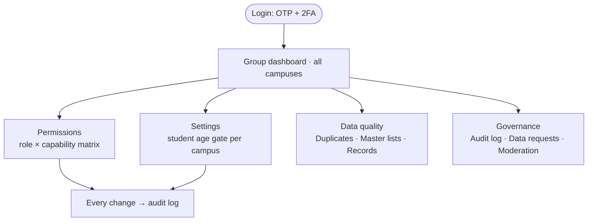
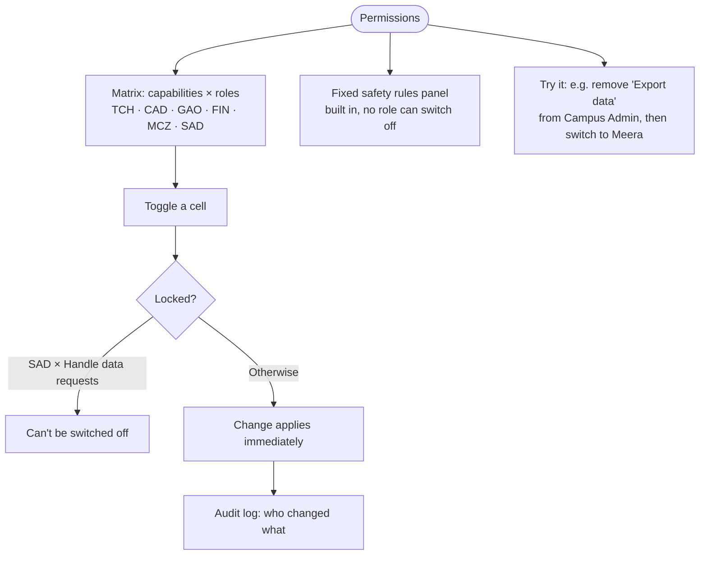
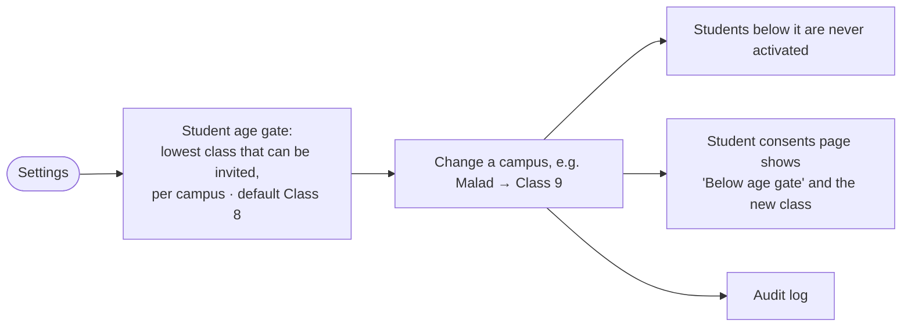

# VIBGYOR Alumni Platform: Super Admin Flow

> Role code **SAD**. Built from the prototype source (`src/components/AppShell.tsx`, `components/Homes.tsx` → `StaffDashboard`, `app/portal/admin/permissions/page.tsx`, `app/portal/admin/settings/page.tsx`, `lib/store.tsx` → `setPermission` / `setMinClass`, `lib/data.ts` → `seedPermissions` / `capabilityLabels`). Demo persona: **Rahul Menon (`sad1`)**, Platform owner · 2-factor. See [CAD-FLOW.md](CAD-FLOW.md) and [GAO-FLOW.md](GAO-FLOW.md) for the shared admin pages.

---

## 1. What the Super Admin is on the platform

| Item | Detail |
|---|---|
| Who | Platform owner |
| Login | OTP + **2-factor** |
| Scope | **All 39 campuses** |
| Main job | Decide who can do what (**Permissions**), platform settings (**Settings**: student age gate), data quality and governance |
| Deliberately **not** by default | Approving verifications, reading student–mentor chats, sending broadcasts (kept with the alumni offices) |

### Menu

| Section | Pages |
|---|---|
| — | Dashboard (group) |
| Queues | Verification · Safeguarding · Moderation · Data requests · Jobs & events |
| People & data | Alumni records · Engagement log · Student consents · Duplicates · Master lists |
| Communication | Broadcasts |
| Governance | Audit log · **Permissions** · **Settings** |

### Default permissions for SAD

| Capability | SAD |
|---|---|
| View / edit / export records | ✅ |
| Moderate content | ✅ |
| Merge duplicates | ✅ |
| Edit master lists | ✅ |
| Handle data & privacy requests | ✅ (**locked on**, can't be removed) |
| Approve alumni verification | ❌ |
| Read student–mentor chats | ❌ |
| Send broadcasts | ❌ |
| Log alumni interactions | ❌ |

The pages for the ❌ items open, but those actions are hidden with *"Your role can't …"* until the matrix grants them.

---

## 2. Master flow

---

## 3. Flow 1: Permissions matrix

### Capabilities

| Capability | Default roles |
|---|---|
| View alumni records | CAD · GAO · SAD |
| Edit or deactivate alumni records | CAD · GAO · SAD |
| Export data (with a reason) | CAD · GAO · SAD |
| Approve alumni verification | CAD · GAO |
| Read student–mentor chats | CAD · GAO |
| Send broadcasts | CAD · GAO |
| Moderate reported content | CAD · GAO · SAD |
| Merge duplicate records | GAO · SAD |
| Edit master lists | GAO · SAD |
| Handle data & privacy requests | CAD · GAO · SAD |
| Log alumni interactions | TCH · CAD · GAO |

### Fixed safety rules (shown on the page, can't be changed)

1. Students see and contact only Mentor-badged alumni (CS-4)
2. Contact details are masked in student chats (CS-6)
3. Student chats can't be deleted by anyone (CS-5)
4. Every staff view or export of student data is logged (CS-16)
5. Staff accounts always use 2-factor login (A13)
6. Campus Admins only see their own campus (A6)

Only the Super Admin can edit the matrix; other staff see it read-only.

---

## 4. Flow 2: Settings (student age gate)

Settings is the only admin page that refuses other roles: *"Settings are for the Super Admin."*

---

## 5. Flow 3: Data quality and governance

Same pages as the Group Alumni Office, all campuses:

| Area | What SAD does |
|---|---|
| **Duplicates** | Merge records field by field, or mark *not duplicates* |
| **Master lists** | Map spellings to colleges / courses / industries, manage aliases |
| **Alumni records** | Edit, deactivate, export with a reason |
| **Data requests** | Access, correction, deletion, complaint; 30-day due date |
| **Moderation** | Dismiss / remove / warn on reported posts, profiles, jobs |
| **Audit log** | Read and export (reason required) every admin, consent, safeguarding and data-access action |

---

## 6. Gaps and fixes

| # | Item | Status |
|---|---|---|
| 1 | `verify`, `chats.read`, `broadcast.send`, `records.view` weren't checked, so SAD could approve verifications, read chats and send broadcasts | ✅ **Fixed.** Those actions now follow the matrix. By default SAD sees *"Your role can't approve verifications / read student chats / send broadcasts"*; switching a cell on in Permissions enables it immediately |
| 2 | Admin pages had no role guard | ✅ **Fixed** (`AdminOnly` on every admin page) |
| 3 | FIN and MCZ campus assignments are fixed in seed data | Open: *Staff & scopes* page to assign campuses per staff user |
| 4 | No way to create or remove staff accounts | Open: staff management page with invite, role, campus, 2FA reset |

---

## 7. Quick demo script

1. Log in as **Rahul** (OTP + 2FA) → Group dashboard.
2. **Permissions** → switch off *Export data* for **CAD** → switch to **Meera** → Alumni records: Export button is gone.
3. Try switching off *Handle data requests* for SAD: it's locked.
4. **Settings** → set Malad's age gate to Class 9 → as Meera, **Student consents** shows the new gate.
5. **Audit log** → both changes are recorded with who and when.
