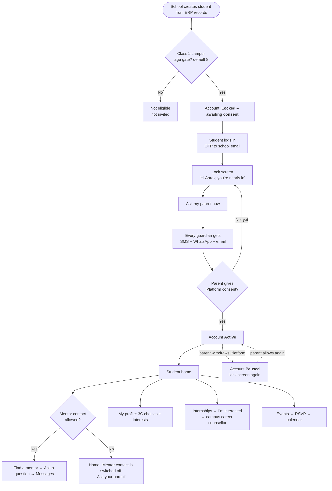
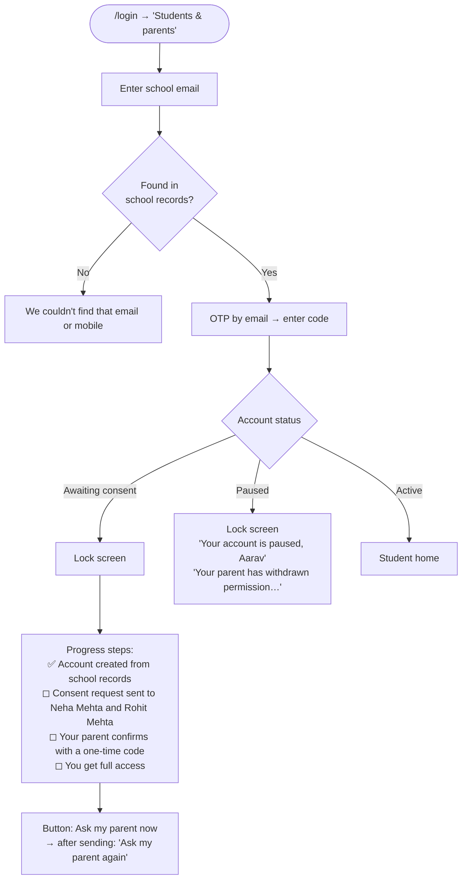
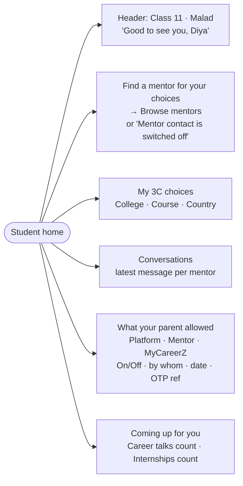
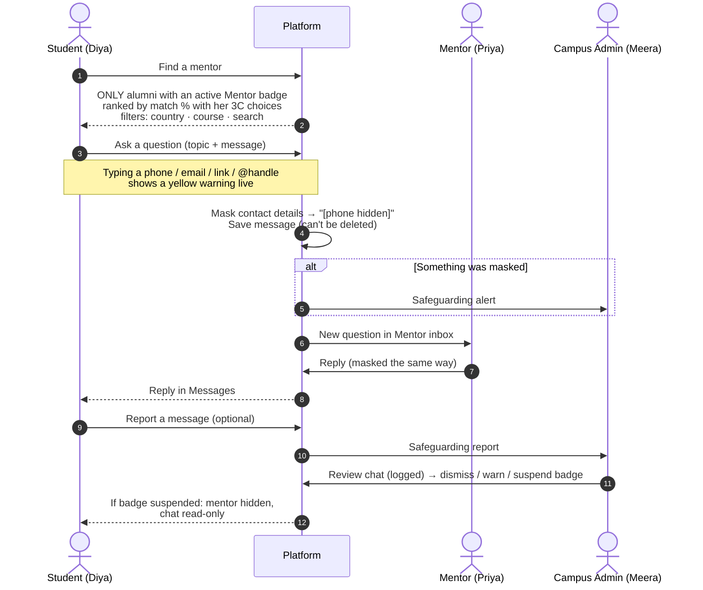
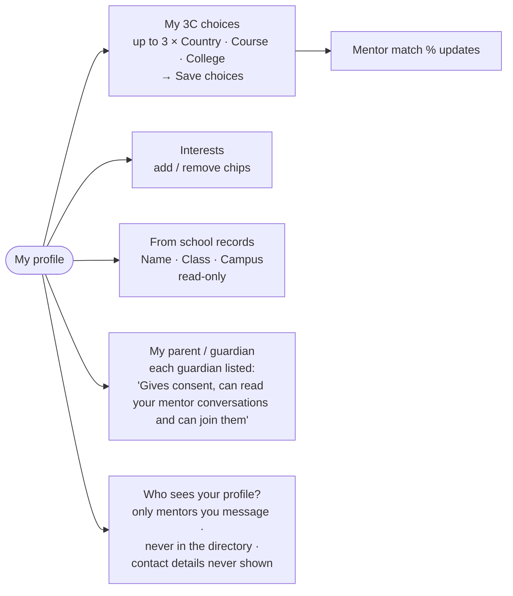
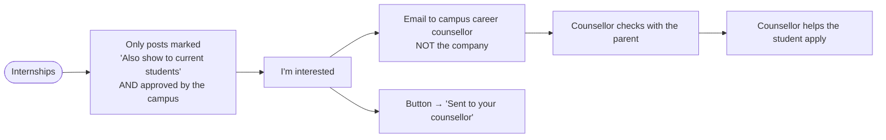
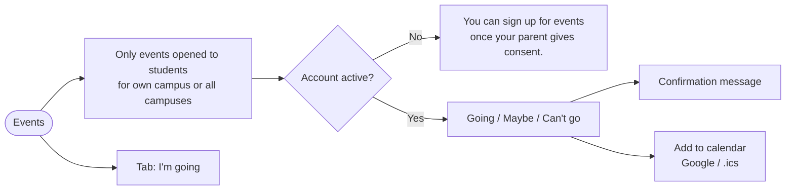
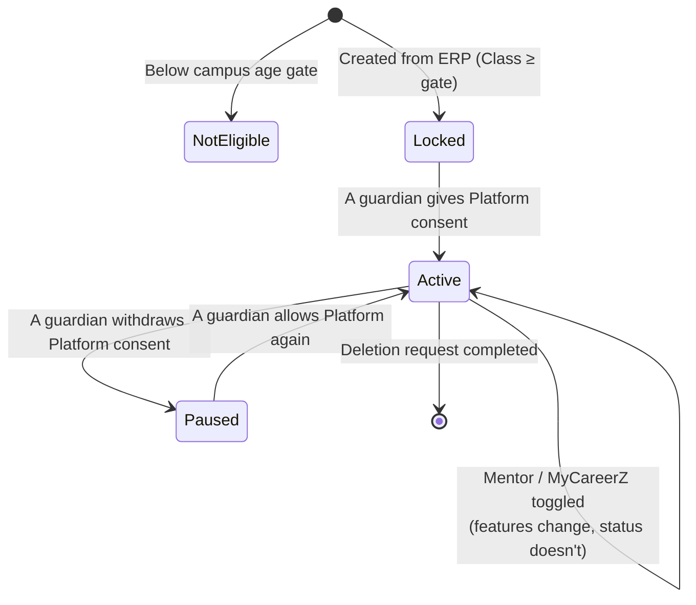

# VIBGYOR Alumni Platform: Student Flow

> Role code **STU**. Built from the prototype source (`src/components/Homes.tsx` → `StudentHome`, `app/portal/mentors/page.tsx`, `app/portal/messages/page.tsx`, `lib/mask.ts`, `app/portal/jobs/page.tsx`, `app/portal/events/page.tsx`, `app/portal/profile/page.tsx` → `StudentProfile`, `components/Gate.tsx`, `components/AppShell.tsx`, `lib/store.tsx`). Demo personas: **Aarav Mehta (`stu1`)**, Class 11, waiting for consent · **Diya Iyer (`stu2`)**, Class 12, consented · **Riya Mehta (`stu3`)**, Class 8, waiting for consent. See also [PARENT-FLOW.md](PARENT-FLOW.md).

---

## 1. What a student is on the platform

| Item | Detail |
|---|---|
| Who | Current VIBGYOR student, **Class 8 to 12** (age gate set per campus by the Super Admin, default Class 8) |
| Why it's special | Under 18, so DPDP Act 2023 needs **verified parent consent** before the account switches on |
| Sign-up | **None.** The school creates the account from ERP records (name, class, campus) |
| Login | One-time code (OTP) to the **school email** (e.g. `aarav.mehta@student.example.in`). No password |
| Scope | Own account, own campus |
| Menu | **Home** · **Find a mentor** · **Messages** · **Internships** · **Events** · **My profile** |

### What a student can do

| # | Action | Where | Needs |
|---|---|---|---|
| 1 | Ask a parent for consent (*Ask my parent now*) | Home (lock screen) | – |
| 2 | See what their parent allowed, by whom and when | Home → *What your parent allowed* | – |
| 3 | Set **3C choices** (Country · Course · College, up to 3) and interests | My profile | Platform consent |
| 4 | Browse **Mentor-badged alumni**, ranked by match with their 3C choices | Find a mentor | Platform + **Mentor contact** |
| 5 | Ask a mentor a question and chat (contact details hidden automatically) | Find a mentor → Messages | Platform + Mentor contact |
| 6 | Report a message | Messages → Report | Platform + Mentor contact |
| 7 | See internships / job-shadowing **approved for students** and tap *I'm interested* | Internships | Platform consent |
| 8 | See student events for their campus, RSVP, add to calendar | Events | Platform consent (to RSVP) |

### What a student cannot do

- ❌ Browse the alumni directory or open alumni profiles (*"For child safety, students and parents can't browse alumni. Students talk only to approved mentors."*)
- ❌ Message any alumnus who doesn't hold an active **Mentor badge**
- ❌ Share or see phone numbers, emails, links or social handles in chat (they're hidden)
- ❌ Delete messages (every message is kept for safeguarding)
- ❌ Make video calls (not in Release 1; from Release 2, booked through the platform only)
- ❌ Contact employers directly (interest goes to the campus career counsellor)
- ❌ Change their own consent (only a parent can, from the Parent portal)
- ❌ Edit name, class or campus (from school records; *"Ask your class teacher to update the school record"*)
- ❌ Join batch groups, alumni chats, vouching, or post jobs

---

## 2. Master flow (end to end)

---

## 3. Flow 1: Login and the lock screen

Login callout: *"Students and parents don't need to sign up. Your school creates your account from school records. Students: your parent gets a message to give consent first."*

While locked, the other menu pages explain why they're closed: Find a mentor shows *"Your account needs a parent's consent first."*, Events and Internships show the items but the buttons are disabled.

---

## 4. Flow 2: Student home (after consent)

*"Only your parent can change these, from their Parent portal."*

---

## 5. Flow 3: Find a mentor and ask a question (safe messaging)

### Match and visibility rules

| Rule | Detail |
|---|---|
| Who appears | Verified alumni with an **active Mentor badge** (signed the 6-point safeguarding code, approved by Campus Admin) |
| Ranking | Match % against the student's 3C choices; a college match is the strongest signal |
| What the student sees of a mentor | Name, batch, college, course, current role, short bio. **Never contact details** |
| What the mentor sees of the student | First name, class and 3C choices only |
| Banner | *"Every mentor is a verified VIBGYOR alumnus who has signed the safeguarding code. Conversations stay on the platform and are visible to your campus alumni office and your parent."* |

### What gets hidden in messages

| Typed | Shown as |
|---|---|
| Phone number (8+ digits) | `[phone hidden]` |
| Email (incl. `name (at) mail (dot) com`) | `[email hidden]` |
| Link / website (`https://`, `www.`, `site.com`) | `[link hidden]` |
| Social handle (`@name`) | `[handle hidden]` |

A masked message carries a *"masked · campus notified"* tag.

### When a chat becomes read-only

| Cause | Student sees |
|---|---|
| Parent switches off Mentor contact | *"Your parent has switched off mentor contact, so this conversation is read-only."* |
| Account paused (Platform consent withdrawn) | Lock screen; chat read-only |
| Mentor badge suspended | *"This mentor is currently unavailable. The conversation is read-only."* |

Past messages are always kept for safeguarding.

---

## 6. Flow 4: My profile

---

## 7. Flow 5: Internships

Callout: *"When you tap 'I'm interested', your campus career counsellor gets the request, not the company. They check with your parent and help you apply."*

---

## 8. Flow 6: Events

*"You only see events your campus has opened to students. Talks happen in school or online with teachers present."*

**Online events: Join now.** Online events (webinars) show a **Join now** button next to the RSVP buttons:

| When | Button |
|---|---|
| More than 15 min before start | Disabled: *Join opens in 2 days 4 h* (counts down by itself) |
| From 15 min before start until the end | **Join now** (green), only if you tapped **Going**; otherwise *Tap "Going" to join* |
| While running | Red **Live now** tag on the card |
| After the end | *Ended* |
| Student without parent consent | Disabled |

Pressing **Join now** records attendance and opens the webinar room link. Students' camera and mic stay off; questions go through moderated chat. Staff see *N joined online* on **Jobs & events**. Demo: a *"Live now: Ask an engineer working abroad"* webinar is created fresh on every demo reset, so Join now can be tried straight away (Diya and Lakshmi are already registered).

---

## 9. Student status lifecycle

| Status | Home | Mentors | Messages | Internships | Events |
|---|---|---|---|---|---|
| **Below age gate** | *Not open for your class yet* (no consent request possible) | 🔒 | Empty | View only | View only |
| **Locked** | Lock screen + *Ask my parent* | 🔒 | Empty (no chats yet) | View only | View only |
| **Active**, Mentor off | Full home + *Ask my parent to allow mentor contact* | 🔒 *switched off* + same button | Read-only | ✅ | ✅ |
| **Active**, Mentor on | Full home | ✅ | ✅ | ✅ | ✅ |
| **Paused** | Lock screen (*paused*) | 🔒 | Read-only | View only | View only |

---

## 10. What is recorded about a student

| Record | Who can see it |
|---|---|
| Consent records (purpose, given by, time, OTP ref, notice version) | Student (summary on home), guardians, Campus Admin / GAO |
| Every mentor message, incl. masked ones | Student, mentor, **parent / guardian (can read and join)**, campus alumni office (staff and parent views are logged) |
| Safeguarding alerts and reports | Campus Admin / GAO |
| Internship interest | Campus career counsellor |
| Audit log entries (consent, interest, sign-in) | Admin roles |

Data download / correction / deletion for a student is done **by the parent** from the Consent centre (*"<Child>'s data"* card).

---

## 11. Gaps and fixes

| # | Item | Status |
|---|---|---|
| 1 | A student below the age gate fell through to the normal home | ✅ **Fixed.** Below-gate students (e.g. Advait, Class 7) see *"Not open for your class yet"*. No consent request can be sent, the consent link says *"This link is not active"*, and the admin *Remind all* skips them. The gate uses the campus's current setting, so raising it in Settings also stops new activations. Students already active are not affected |
| 2 | No button to ask a parent for mentor contact | ✅ **Fixed.** *Ask my parent to allow mentor contact* on Home and Find a mentor sends every guardian a WhatsApp starting `[Child · Class N]` with a link to the Consent centre |
| 3 | Students can't see or download their own data; only the parent can | Open: policy decision for when the student turns 18 or leaves school |

---

## 12. Quick demo script

1. Log in as **Aarav** (`aarav.mehta@student.example.in`) → lock screen → **Ask my parent now**.
2. Device simulator: messages go to **Neha** and **Rohit**, each starting `[Aarav · Class 11]`. Open one link and consent (allow Mentor contact).
3. Back as **Aarav**: home is open, *What your parent allowed* shows who consented.
4. Log in as **Diya** → **Find a mentor** → mentors ranked by match → **Ask a question** with a phone number → yellow warning → send → shows `[phone hidden]`.
5. **Report** a message. Switch to **Meera** → **Safeguarding**: alert and report are waiting → **Suspend badge**. Back as Diya: the mentor is gone and the chat is read-only.
6. As Diya → **Internships** → **I'm interested** → *Sent to your counsellor*.
7. As Diya → **Events** → **Going** → add to calendar.
8. As **Neha** → Consent centre → switch off Mentor contact for Aarav → as Aarav, Find a mentor is locked.
