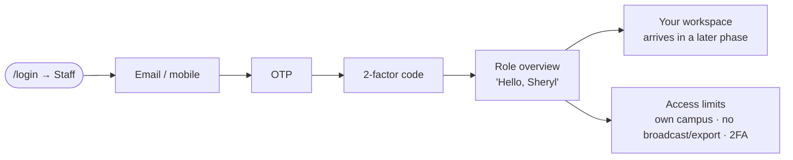
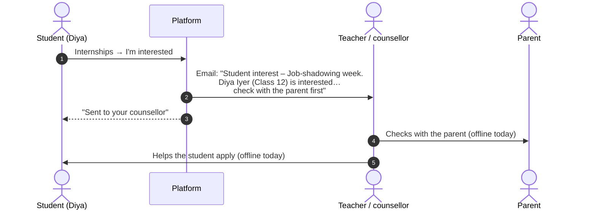
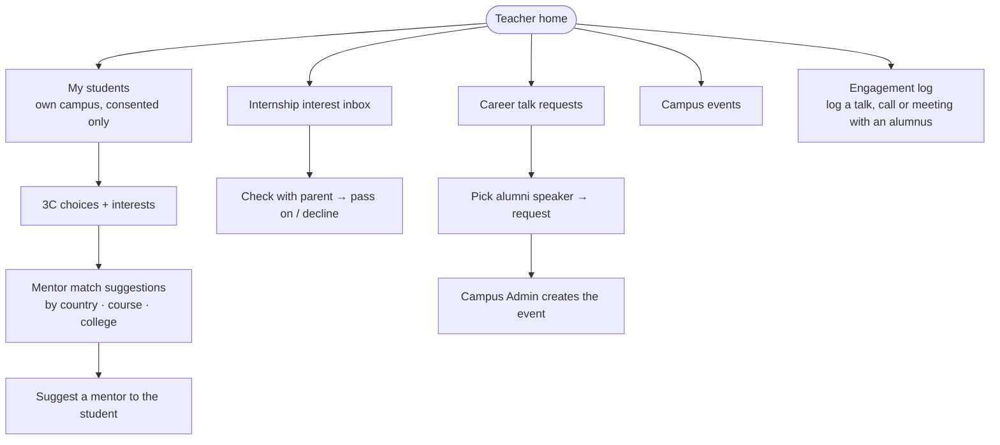

# VIBGYOR Alumni Platform: Teacher / Counsellor Flow

> Role code **TCH**. Built from the prototype source (`src/components/Homes.tsx` → `RoleOverview` / `roleFeatures.TCH`, `components/AppShell.tsx`, `app/login/page.tsx`, `lib/store.tsx` → `markInterest`, `lib/data.ts` → `seedPermissions`, `app/portal/admin/engagement/page.tsx`). Demo persona: **Mrs. Sheryl Fernandes (`tch1`)**, Teacher · Malad. See also [STUDENT-FLOW.md](STUDENT-FLOW.md) and [CAD-FLOW.md](CAD-FLOW.md).

> ⚠️ **Prototype status:** the teacher sees a **role overview** only. The full workspace is planned for a later phase. This file shows what is built today and the planned flow.

---

## 1. What a teacher / counsellor is on the platform

| Item | Detail |
|---|---|
| Who | Class teacher or career counsellor at one campus |
| Login | OTP + **2-factor** (all staff) |
| Scope | **Own campus only** |
| Menu (today) | **Home** (role overview) · **Engagement log** |
| Capabilities (default matrix) | `engagement.log` (log alumni interactions). Nothing else |

### Built today

| # | What | Where |
|---|---|---|
| 1 | Sign in with OTP + 2-factor code | `/login` |
| 2 | See the role overview: planned workspace and access limits | `/portal` |
| 3 | **Receive students' internship interest** by email: *"Student interest – <job>. <Student> (Class N) is interested… Please check with the parent before passing the application on."* | Email (first teacher on the student's campus) |
| 4 | Log alumni interactions, own campus (single or bulk CSV) | Engagement log |

### Planned workspace (from the role overview)

| Feature | Purpose |
|---|---|
| Student 3C preferences and interests | See what each student is aiming for |
| Mentor match suggestions | Suggest the right mentors to students |
| Career talk requests | Ask alumni to give talks at the campus |
| Campus events | See and promote campus events |

### Access limits

- ✅ Own campus only
- ❌ Can't broadcast
- ❌ Can't export data
- ❌ Can't read student–mentor chats, approve verifications, or moderate
- ✅ 2-factor login

---

## 2. Flow 1: Login

---

## 3. Flow 2: Student internship interest (built)

Students never contact employers directly. The company only hears from the counsellor.

---

## 4. Flow 3: Planned teacher workspace

---

## 5. Gaps and fixes

| # | Item | Status |
|---|---|---|
| 1 | Teacher had `engagement.log` but no menu link, and the page blocked them | ✅ **Fixed.** TCH menu: **Home · Engagement log**. The page allows TCH, scoped to their own campus |
| 2 | Internship interest goes to the **first** teacher found on the campus, with no inbox to track it | Open: teacher inbox with status (checking with parent / passed on / declined) |
| 3 | Admin pages had no role guard | ✅ **Fixed.** A teacher opening any other admin page sees *"Staff only"* |
| 4 | Whole workspace (3C view, match suggestions, talk requests) not built yet | Planned for a later prototype phase |
